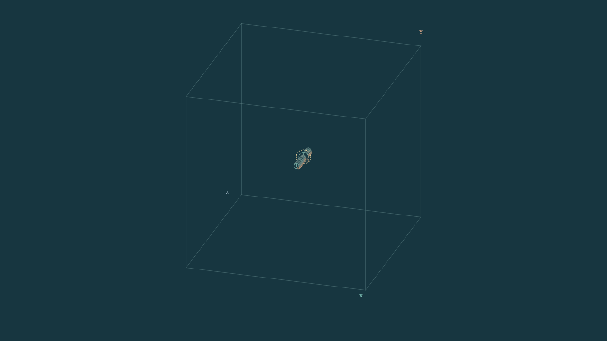
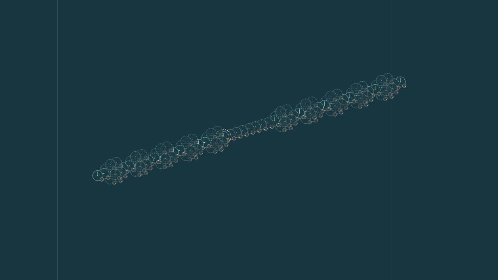

# Universe24

**Could reality be built from integers?** Universe24 is a research project initiated by **Alon Gonen** to investigate whether one simple, local, reversible rule could underlie the complexity of physical reality.

This repository provides the **MIT-licensed reference engine for one specific mathematical candidate**: an integer-valued cellular automaton with **Rule3**, 48 group-labelled channels per site and a fixed signed spatial coupling. **The broader scientific proposal and the present code are not the same thing.**

> **Research status:** This repository is a mathematical and computational research prototype, **not a validated physical theory**. No derivation of photons, atoms, quantum measurement, physical energy, angular momentum, gravity, or the Born rule is claimed.

**Start here:** [Run and compose building blocks](#run-and-compose-building-blocks) · [Component API](docs/COMPONENTS.md) · [Results and limits](docs/COMPONENT_RESULTS.md) · [Independent review](docs/COMPONENT_REVIEW.md) · [Full research proposal](https://docs.google.com/document/d/1NDPfeFj9vldgb0RMSSvx2lBSmOo__E-F3t2cZwfjOjI/edit) · [Mathematical model](docs/MODEL.md) · [The Presenter](docs/PRESENTER.md) · [Contributor rules](AGENTS.md)

**Clock-mediated research:** [Building blocks and run commands](docs/CLOCK_SELECTION.md) · [Protocols, verified results and recordings](research/clock_selection/README.md) · [Hypotheses and decisions](research/clock_selection/decision_ledger.md) · [Physical targets](research/clock_selection/physics_targets/README.md). This research separates signal-written phase and conditional probe response from internally generated approval, complexity preference and physical interpretation. The full-state negative controls and corrected observer failures remain part of its evidence.

## The research question — beyond this code

The premise being tested is that **space, time, waves, matter and observed measurement events might be emergent behaviors of exact integer states**, rather than separately programmed kinds of objects. Each elementary node would obey the **same local law**; different initial patterns and interactions would produce different large-scale phenomena.

The project works in **two directions**: derive requirements from known physics and measured detector events, then build explicit candidate dynamics and compare their predictions with those requirements. A central research question is whether internal recurrent patterns could act as clocks and whether interactions could produce persistent, exclusive detector records — without adding a detector-specific command.

The broader proposal also asks whether coherent interference, entanglement, physical conservation laws, stable matter and spacetime geometry can be recovered. These are **open research goals**, not features already implemented in the engine.

Universe24 combines science with the philosophy of science. Conceptual analysis clarifies what counts as a physical explanation, a clock, a measurement and a recorded outcome; mathematical derivation, reproducible computation and comparison with physical observations test the proposed account. The idea that nature favors greater joint structured complexity is a guiding philosophical conjecture to formulate and test, not an established law or a proven consequence of Rule3.

**Existing hypothesis H16** proposes that observed joint click histories may be the records of admissible full joint histories maximizing pre-specified joint structured complexity. Its possible connection to quantum entanglement, probabilities and effective collapse is an **additional hypothesis**, not a consequence already derived from the maximum criterion. The [hypothesis and its test conditions](docs/RESEARCH_PROPOSAL.md#5-proposed-clicks-and-the-unresolved-selection-problem) preserve the unchanged dynamics and full-state information. The registered finite `C_pair` version had [ten eligible comparisons and ten counterexamples](docs/PATH_SELECTION_BLOCK.md#results); that failure remains part of the evidence.

**Three distinctions for new readers:**

1. **Proposal ≠ established physics.** The [living scientific document](https://docs.google.com/document/d/1NDPfeFj9vldgb0RMSSvx2lBSmOo__E-F3t2cZwfjOjI/edit?usp=drivesdk) describes postulates, competing hypotheses, earlier variants and quantitative targets.
2. **Mathematical candidate ≠ all proposed mechanisms.** The code implements the single-board, six-spatial-neighbor Rule3 candidate. The historical Clockwork G and alternative H9a are comparisons, not hidden extra stages.
3. **Arithmetic event ≠ physical detector click.** The three external remainder classes are bookkeeping on completed transitions. The engine has **no built-in history chooser or cancellation gate**.

For the full framing, what is derived and what remains open, read the [concise proposal summary](docs/RESEARCH_PROPOSAL.md) before the technical sections below. The Google Doc may require access permissions from its owner.

## The algebra and what it represents

### Complete state and fixed coupling

The board is the periodic cube `x in (Z/LZ)^3`, with `L >= 3`. At each site,
`g in 2O` indexes 48 channels. The binary octahedral group `2O` is the 48-element unit-quaternion
double cover of the 24 proper rotations of a cube. The labels `g` and `-g`
have the same spatial rotation but remain distinct channels. The group label
chooses a channel and its connection geometry; it does not choose among 48 update rules. Each channel
stores exactly

```text
S[x,g] = (a[x,g], b[x,g], r[x,g])
a,b are arbitrary-precision integers; r is one of 0,1,2,3,4,5.
```

For each of the six spatial directions `d`, the fixed tensor supplies one
sender channel `P[d,g]` and one sign `w[d,g]`. Every receiver uses

```text
u_t[x,g] = sum_d w[d,g] * b_t[(x+d) mod L, P[d,g]].
T[d,g,h] = w[d,g] if h=P[d,g], otherwise 0.
```

All six inputs come from the same complete old snapshot. A negative sign
changes a contribution, and a zero matrix entry is not a deleted spatial port.

Here `q_y` and `q_z` are the chosen unit-quaternion lifts of positive
quarter-turns about Y and Z. The shorthand `(0,1,3)` names fixed group-action
exponents, not three forces or three update rules. The current body actions are `B[+x]=B[-x]=identity`, `B[+y]=q_y`,
`B[-y]=q_y^-1`, `B[+z]=q_z^3`, and `B[-z]=q_z^-3`. If `R(g)` is the spatial
rotation of channel `g`, the body direction is `e=R(g)^-1 d`, the port is
`P[d,g]=g B[e]`, and `w[d,g]` is the preselected sign of the body axis of `e`.
Thus three global signs `(s_x,s_y,s_z)` supply the eight currently implemented
couplings. They are not eight independent choices at every channel. The
coupling is chosen before execution and is constant throughout the run.

### Rule3 and its inverse

For every channel, the only forward update is

```text
ell, r_next = divmod(2*u + r, 6)
a_next = b
b_next = ell - a
```

`divmod` is Euclidean division: `2*u+r = 6*ell+r_next` and
`0 <= r_next < 6`, including when `u` is negative. This is the existing
`num=den=1` rule. Every next value is calculated from the same old state;
there is no runtime source insertion, gate, selector, detector reset or
coupling change.

Let `F(b)` denote the complete fixed six-neighbor input map. The exact inverse
of a complete next snapshot `(a_next,b_next,r_next)` is

```text
b = a_next
u = F(a_next)
r = (r_next - 2*u) mod 6
a = (2*u + r - r_next)/6 - b_next
```

The recovered remainder makes the division exact. Since the old `b` field is
the known next `a` field, every old input is available before inversion.
This proves bijectivity on the full integer state for the fixed tensor.
Rewind is used for audit, not as a second forward operation. Finite inverse
tests check the implementation; they are separate from this algebraic proof.

### Clocks, gears, memory and C events

The counter dial displays the direction of `(a,b)`; `(0,0)` has no direction.
Its normalized hand does not display magnitude, so the exact integers remain
available. The remainder gear displays `r`. An equivalent lossless form is

```text
r = 2*theta + epsilon, with theta in {0,1,2}, epsilon in {0,1}
epsilon_next = epsilon
u + theta = 3*ell + theta_next.
```

Both the phase and parity bit belong to the full state. The drawings and
camera are passive readings of saved states, not additional mechanical laws.

If the actual net input remains zero, `ell=0` and
`(a,b,r) -> (b,-a,r)`. A nonzero counter pair then rotates with period four;
the zero pair is fixed. Thus hands can move between signal arrivals. Their
motion is not automatically a click or a unit of physical time.

The existing arithmetic readout records `C` only when `ell != 0` **and** the
full channel triple changes. Its class is `u mod 3`, equivalently
`((r_next-r)/2) mod 3`. A remainder change `R` is a separate observation:
it can occur with `ell=0` and therefore without C. These observations do not
alter evolution or select a path.

The counter quantity used by the finite memory example is `I=a*a+b*b`, with
the exact identity `I_next-I = ell*ell - 2*a*ell`. It is not generally
conserved and has not been identified as physical energy. The demonstrated
levels `0 -> 1 -> 4` are a scoped response of the declared preparation.

### What separate and composed runs mean

A component recipe supplies initial triples, named existing addresses and
passive readouts. It has no private clock or runtime updater. The composer
places the recipes on one board and takes a **consistent union** of their
assignments. Identical shared triples are allowed with provenance;
different triples at the same address are rejected. It never adds counter
states or lets a later component overwrite an earlier one. Explicit sockets
reserve unassigned locations for compatible initial preparations. Named
ports do not add connections to the lattice. All components must use the
same complete tensor and background.

An isolated component run evolves its entire declared board and environment.
A composed run evolves one jointly prepared board. Saved isolated runs
cannot generally be combined afterward: the six-input sum is linear in old
`b`, but the quotient/remainder update is not linear. For example, at the
same initial remainder `r=2`, a unit input gives `ell=0`, whereas two unit
contributions arriving together give total `u=2` and `ell=1`. This is a
statement about incoming contributions to one update, not permission to add
two independently prepared full states.

Locality gives a precise sufficient condition for limited independence.
Agreement of the complete initial states on a region's backward dependence
cone of radius `T`, using periodic lattice distance, guarantees identical
observed trajectories in that region through `T` updates. This is sufficient,
not necessary for coincident outputs. The agreement includes all 48 channels,
remainders and the full declared background or shared guide. With a common stationary
reference preparation, disjoint disturbance cones give the corresponding
isolated behavior until the cones meet. Once signals can interact, the joint
trajectory must be checked directly; initial compatibility is not a proof
of functional compatibility.

The four-placement example is two `SignalSource` instances, one `GuideSegment`
and one `Receiver`: three recipe types and four initial placements. The
receiver's clock and memory are two readings of the same counters. Its source
controls establish a finite source-driven response, not an autonomous
uniqueness approval, a general preference for complexity or physical light.

A proper orientation lift `h` transforms a prepared address as
`(x,g) -> (R(h)x+t,hg)`. Positions and channel labels move together, along
with ports, sources and readouts. Rotating only positions creates a different
channel preparation. The two lifts of one spatial rotation can produce
different channel labels. Sparse storage omits only the declared background;
zero-counter channels with another remainder are still retained.

## Get started

Requirements: **Python 3.11+**. Running from the repository requires **no third-party Python packages**.

```bash
git clone https://github.com/Closer24/Universe24.git
cd Universe24

python -m research.experiments.materialize_evidence
python -m unittest discover -s tests -v
python -m universe24 --config examples/impulse.json --audit
```

The default `main` branch includes the component library, Presenter and
reproducibility tools. Reliability PR #2, clockwork PR #3, coupling-documentation
PR #4 and generic-component PR #5 have been merged. The original research
branches and immutable evidence references remain available.
The materializer restores declared, hash-checked evidence from the included
archive for the full tests and historical audits; it never replaces live code.

For an example with signed couplings and read-only event logging:

```bash
python -m universe24 --config examples/signed_impulse.json --audit --events events.jsonl --output final.json
python -m universe24 --resume final.json --steps 10 --audit
```

**Note:** Output files passed to `--events` or `--output` must not already exist. Delete or choose a different output filename before another run. The `--resume` option takes a **full-state checkpoint**, not an event log; it performs additional *forward* Rule3 updates.

For a complete command reference and a minimal seed example, see [Quickstart](docs/QUICKSTART.md). For all supported input fields, see [Experiments](docs/EXPERIMENTS.md).

## What may vary between experiments?

**Before the run:** the single cube side `L`; one of eight fixed body-axis sign combinations (`[+1,+1,+1]` reproduces the positive reference coupling); the initial values of the channels; and the number of reference steps.

The implemented body actions remain fixed at `(0,1,3)`. [Algebraic degrees of freedom and coupling families](docs/COUPLING_FAMILIES.md) separates the state and preparation choices from a broader axial-action candidate: 512 labeled port tensors, or 4096 labeled signed tensors before equivalence classification. That broader family is documented mathematically; it is not available in the current engine or configuration.

**During the run:** no experiment code may change Rule3, coupling signs, graph topology, node state, or scheduling semantics. Every evolution step is computed only by the generic engine.

**Outside the run:** observers may count and classify arithmetic transitions, inspect states, export event logs, and check the mathematical inverse and balance identities. Observations do not feed back into the state.

## Run and compose building blocks

An initial-state component is an immutable pattern of triples, together with
named addresses, sockets and readouts. A recipe prepares that pattern before
the run. It does not install a private particle, detector or gate updater.

| Layer | Location | Responsibility |
| --- | --- | --- |
| Reference engine | `universe24/` | Fixed Rule3, topology, coupling and complete states |
| Component library | `research/components/` | Data-only recipes, placement and conflict checks |
| Experiments | `research/experiments/` | Choose preparations, run the engine, record complete states and inspect outcomes |
| Presenter | `research/presenter/` | Replay recorded states as clocks and gears |

Recipes include `SignalSource`, `GuideSegment`, `Receiver`, `PairedArm`,
`GuidedPacketSource` and the general `Patch`. Their behavioral claims apply
only to documented preparations, couplings, environments and time windows.

### Select four components for one connected run

This example selects **four instances from three recipes**: two initial
signal sources, one guide and one receiver. The receiver's same counters and
remainders carry its clock and memory readouts; there are no separate clock
and memory evolution rules.

From the repository root, run:

```bash
python -m research.experiments.run \
  --spec research/experiments/examples/four_component_demo.json \
  --output runs/my-four-component-demo
```

Open `runs/my-four-component-demo/The_Presenter.html` in a browser that runs
JavaScript. Select a source control, press **Play**, and drag the cube to
rotate it. **Look inside** exposes the node's 48 channels. The command
computes a new trajectory; **Play** replays saved states. Select components
before a run by editing a copied JSON spec or using the Python API below.
The Presenter is an experiment player, not a visual component editor.

Output directories must be new. Python 3.11 or newer is sufficient, with no
optional visualization dependencies. This command does not require evidence
materialization. The same runner accepts `guided_packet.json`,
`assembled_demo.json` and `selected_examples.json` in the examples directory.

Here is the complete initial assembly in Python:

```python
from research.components import (
    BoardSpec, TensorSpec, SignalSource, GuideSegment, Receiver,
    place, finalize,
)

tensor = TensorSpec.from_signs((1, 1, 1))
origin = (110, 110, 110)
prepared = finalize(BoardSpec(side=221, tensor=tensor), [
    place(GuideSegment(start=-20, stop=28, sockets=(-20, 0, 28),
                       tensor=tensor), at=origin, name="guide"),
    place(Receiver(tensor=tensor), at=origin, name="receiver"),
    place(SignalSource(tensor=tensor), at=(90, 110, 110), name="first"),
    place(SignalSource(tensor=tensor), at=(138, 110, 110), name="second"),
])

states = list(prepared.engine.evolve(prepared.initial, 48))
receiver_channels = prepared.ports["receiver.node"]  # all 48 local channels
```

The guide sockets leave the three local positions unassigned for the two
sources and receiver. A socket is an initial-data contract; it adds no
connection to the lattice. All four instances must share the exact same
global tensor and background. Different triples at a shared address are
rejected; identical triples retain all owners in the manifest. The finalizer
does not add counters, average states or accept a last writer. It also
rejects independent sources sharing an address, unfilled sockets and explicit
wrapping that aliases distinct local addresses.

### What the four source controls show

Both sources are initially prepared. Their later effects come from the
closed-board dynamics. An absent-source control zeroes only its initial
counters, retaining the same remainders, guide, receiver and tensor.
The fresh demonstration records all four controls through 48 updates:

| Initially present sources | Receiver C-bearing and remainder-change steps | Receiver magnitude after the final event |
| --- | --- | --- |
| Neither | None; the whole board is stationary | `I=0` |
| First only | 20 | `I=1` in each paired channel |
| Second only | 28 | `I=1` in each paired channel |
| Both | 20 and 30 | `I=4`, following the earlier `I=1` interval |

For both sources, the remainder pair changes
`(4,0) -> (0,4) -> (4,0)` at those two receiver times and stays fixed between
them. Each time contains two individual channel events, in channels 0 and
14: four arithmetic events in total. All 48 receiver channels are observed;
the other 46 remain quiet. This is not a two-photon or exclusive single-event
claim. The final remainder pair returns to its original value; the counter
magnitude `I=4` distinguishes the final state from the initial `I=0`.

The second event occurs at 30 jointly rather than 28 in isolation because
the actual incoming waveform changes through interaction. No external timer
inserts or delays an event. The counter pair rotates between arrivals, while
its magnitude and the stated remainder record remain stable over the tested
intervals. A normalized clock hand alone does not show `I`; inspect the exact
counters or the declared magnitude/phase readouts.

The [four-control recording](research/experiments/evidence/publication_v1/four_component_demo/The_Presenter.html)
retains all 196 full states. The [independent review](research/component_review/publication_demo_review.json)
checks their equality with the earlier controls and all 192 transitions with
separate matrix-based forward/inverse calculations.

Two views replay the same 49 states of the combined preparation:

| Whole periodic cube | Prepared apparatus closeup |
| --- | --- |
|  |  |
| [Rotate the complete cube](research/experiments/evidence/publication_v1/whole_cube_render/sequence-01/recorded-clocks.gif) | [Watch the recorded clocks](research/experiments/evidence/publication_v1/render/sequence-01/recorded-clocks.gif) |

The board is three dimensional; these four placements form a line along its
X axis. Uniform background clocks are omitted from this large-board drawing
and retained in the complete state. The [initial viewer](research/experiments/evidence/publication_v1/initial_view_review.json)
already opens on the whole cube. **Reset view** restores that framing;
**Focus retained state** enlarges the prepared apparatus. Drag to rotate.
The [render verification](research/experiments/evidence/publication_v1/whole_cube_verification.json)
checks identical recorded states and all eight cube corners inside every frame.

This is a finite composition result for this preparation, not indefinite
reuse, a guide-ablation result, physical light or unique-path confirmation.

### Run individual components on separate boards

Separate runs give each preparation its own complete board and environment.
They do not exchange signals. This command records three such experiments:

```bash
python -m research.experiments.run \
  --spec research/experiments/examples/standalone_components.json \
  --output runs/my-separate-components
```

The receiver alone and guide alone have zero counters and stay stationary,
as Rule3 requires. That is their resting behavior; it does not test a response
to an incoming signal. A standalone `SignalSource` is a prepared disturbance;
its name does not guarantee a mobile ray. The verified compact moving packet
requires `GuidedPacketSource`, its complete remainder halo and its declared
periodic guide together, as specified in `guided_packet.json`.

In Python, a receiver-only board is:

```python
receiver_only = finalize(BoardSpec(side=33), [
    place(Receiver(), at=(16, 16, 16), name="receiver"),
])
separate_states = list(receiver_only.engine.evolve(receiver_only.initial, 8))
```

A separate call to `finalize` with a guide creates a different board. Putting
compatible placements into one call creates one shared board. Their influence
can then travel only through the existing six spatial connections. Running
separately, running together and adding recorded trajectories afterward are
three different operations. The carry example in the algebra section explains
why post-hoc addition does not reproduce a joint run.

### Complete evidence and limits

All `universe24/` files remain unchanged. The original full suite passed
120 tests. The initial publication candidate passed [all 124 tests](research/experiments/evidence/publication_v1/validation.json).
After bounded archive transport was added, the revised candidate passed
[all 127 tests](research/experiments/evidence/publication_v1/parts_validation.json)
with zero failures, errors or skips in a fresh Git checkout containing only
the archive parts. Seven tests exercise evidence restoration and reject missing,
corrupt or reordered parts. The report pins the tested source tree. Separate
checks reproduced the four component controls and standalone examples.
Historical provenance tests need Git history: an initial file-only test copy
produced three Git-context errors, [preserved here](research/experiments/evidence/publication_v1/initial_no_git_validation.json);
the same source passed in the documented Git environment. The [pinned delivery archive](research/artifacts/Universe24_Components.parts/manifest.json)
retains 1,234 new study recordings, 51,638 complete states, frozen protocols
and source snapshots. Its exact 44,029,448 bytes are stored as 42 numbered
parts because the publication connector could not transfer one large blob.
The same command reassembles them in memory, verifies every part and the
unchanged full-archive checksum, and then restores the data. No extra setup
step or network access is required. Restore their original evidence paths and the 24
Presenter import parts with:

```bash
python -m research.experiments.materialize_evidence --check-only
python -m research.experiments.materialize_evidence
python -m unittest discover -s tests -v
```

This offline checksum-locked materializer writes only declared research
evidence, including frozen historical source snapshots. It cannot replace
live engine, recipe, runner, test, documentation or configuration files. It
rejects path escapes and differing existing files. After restoration,
`research/experiments/evidence/assembly_v1/complete_collection/index.html`
lists every recording and import part. The generic example commands work
without this restoration step.

Software correctness and scientific acceptance remain separate. Guided packet
translation has a proof for its exact prepared periodic guide. Finite OR/NO
competition works in its stated cases. The larger cooperation-score prediction
failed all ten eligible comparisons; strict waiting accepted none of 145
preparations. A joined route activates its receiver at step 12 but the record
changes again at step 14, so one-click persistent confirmation is unestablished.
The [claim ledger](docs/COMPONENT_RESULTS.md) preserves these limits.

The rendering logic was checked using DOM/native Canvas2D. Actual Safari/iPad
playback is unverified. An attachment preview may disable JavaScript; its
static experiment list cannot play or rotate. Download a recorded HTML file
and open it in a browser that executes its scripts.

## Repository map

```text
universe24/
  core/
    group_2o.py       exact 2O construction, multiplication, rotations
    coupling.py       fixed signed six-direction 48×48 coupling
    state.py          immutable state on the periodic cube
    rule3.py          sole scalar forward law and its inverse
    engine.py         pure reference executor; same-snapshot updates
  experiments/
    config.py         JSON seeds and full-state checkpoints
  observation/
    clicks.py         external C0/C1/C2 arithmetic event classification
    diagnostics.py    exact audit and algebraic accounting
  __main__.py         CLI
examples/             impulse, signed impulse, prepared clock
tests/                automated contract tests
docs/                 model, usage, architecture, observation, research status
AGENTS.md             non-negotiable development constraints
CONTRIBUTING.md       safe modification and review process
```

## What has and has not been established?

- The specification defines an exact, reversible full-state update; the source includes inversion and algebraic contract tests.
- The signed coupling is a choice made **before** simulation, not an evolving field. The model retains six spatial ports even when a matrix entry is zero.
- The three `Ck` labels classify **guarded nonzero-carry transitions** by their modulo-three remainder change. A remainder change alone need not be a click. `C2` is **not** an automatically selecting detector click.
- A passive output `Click` record is an analysis object written outside the automaton; it is **not** an internal memory cell.
- Mathematical reversibility, finite cube symmetry and balance identities do not establish physical conservation of energy/angular momentum or quantum measurement.
- Candidate detector selection, autonomous cancellation, robust protected records, physical time and empirical predictions remain open research.

See [Research status and acceptance criteria](docs/RESEARCH_STATUS.md) before interpreting numerical patterns as physics. For the wider scientific agenda, including its ten foundational postulates, experimental benchmarks and the conditional complexity-selection idea, see [the research summary](docs/RESEARCH_PROPOSAL.md) and [the full Google Doc](https://docs.google.com/document/d/1NDPfeFj9vldgb0RMSSvx2lBSmOo__E-F3t2cZwfjOjI/edit?usp=drivesdk).

## Collaboration and license

Read [CONTRIBUTING.md](CONTRIBUTING.md) and [AGENTS.md](AGENTS.md) before changing any code. Proposals that alter the mathematical primitive or topology must be identified as **separate model variants**, not silently merged into Rule3.

Licensed under the repository's [MIT License](LICENSE).

## Author and citation

**Alon Gonen** is credited as the originator of the Universe24 research project. This repository records the current computational implementation; contributions to particular files or later research should be credited separately.

If you use or discuss the Universe24 code, cite **Alon Gonen, *Universe24* (software), GitHub: https://github.com/Closer24/Universe24**. See [CITATION.cff](CITATION.cff) for the machine-readable citation. Cite a specific commit SHA when reproducibility matters. This citation does not imply that the proposed physical interpretation has been established.
