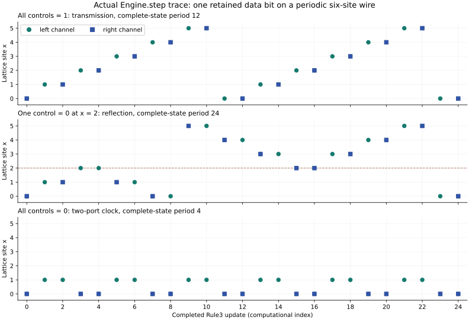

# Bounded circuits inside scalar Rule3

This optional construction gives an exact moving pulse, controlled reflection and periodic clocks using the existing scalar engine. Boundedness holds for every update in its prepared Boolean sector; it is not inferred from a short simulation. The circuit tensor is chosen explicitly and does not replace the default model. Its three active channels are a retained control and two data ports. The fixed wiring does not create evolving geometric links.

## Two local involutions

Write the complete state as $(a,b,\rho)$, reserving $\rho$ for division remainders. At each node the current channels are $b=(c,x,y)$: control, left port and right port. The on-site Fredkin map is

$$
P(c,x,y)=\bigl(c,(1-c)x+cy,cx+(1-c)y\bigr).
$$

For a Boolean control, this either leaves the data ports alone or exchanges them. Thus $P^2=I$, and Boolean data remain Boolean. Algebraically, the identity uses $c^2=c$; it is not an identity on arbitrary integer controls.

Choose one spatial axis $e$. The wire map exchanges disjoint channel instances at neighboring nodes:

$$
(Jc)_n=c_n,\qquad (Jx)_n=y_{n-e},\qquad (Jy)_n=x_{n+e}.
$$

Consequently $J^2=I$. No node reads beyond a face neighbor. The axis is a declared circuit orientation, not full cube-rotation symmetry.

With the fixed divisor $D=6$, choose the tensor

$$
u(b)=\frac D2\bigl(P(b)+J(b)\bigr).
$$

Explicitly, its control input is $u_c=Dc$; its data inputs are

$$
u_x=3[x+c(y-x)+y_{n-e}],\qquad
u_y=3[y+c(x-y)+x_{n+e}].
$$

These are integer polynomials of degree at most two: tensor rank three, within the rank-at-most-four contract. Every product is on-site; each shifted linear term occupies one edge. Construction uses `strict_support=True`. All factors read old `b`, so the old-`a` dependency graph is trivially acyclic.

## Why alternation follows from the retained state

Prepare arbitrary Boolean $b_0$, set $a_0=P(b_0)$, and choose any remainder array with $0\leq\rho_0<D$. Seed preparation only needs:

```text
b = explicit Boolean control and port arrays
a = copy(b)
exchange a.left and a.right where b.control == 1
rho = explicit legal remainder array
```

Every subsequent update is the unchanged scalar Rule3:

$$
(q,\rho')=\operatorname{divmod}(2u+\rho,D),\qquad
a'=b,\qquad b'=q-a.
$$

Because $2u=D(P(b)+J(b))$, Euclidean division gives exactly

$$
q=P(b)+J(b),\qquad \rho'=\rho.
$$

Define two sets of complete states, with Boolean $b$ and legal remainders:

$$
\Gamma_P=\{(P(b),b,\rho)\},\qquad
\Gamma_J=\{(J(b),b,\rho)\}.
$$

Direct substitution proves

$$
W(P(b),b,\rho)=(b,J(b),\rho)\in\Gamma_J,
$$
$$
W(J(b),b,\rho)=(b,P(b),\rho)\in\Gamma_P.
$$

The first transition applies $J$ to the current data; the next applies $P$. Their inverse transitions follow from the same involution identities. Hence the union is invariant in both directions. Where $P(b)=J(b)$, the descriptions overlap consistently. No additional phase bit or runtime phase test is needed: the relation between retained `a` and `b` carries the phase.

Equivalently, the injective encoding $E(b,\rho)=(P(b),b,\rho)$ satisfies $W^2E(b,\rho)=E(PJ(b),\rho)$. This identifies a complete effective two-step map on the prepared sector. It is not a claim to have obtained every desired `num/den` family or a physical field theory.

This is a globally prepared sector: the complete board lies on one phase graph. It is not the full product space of Boolean `a,b` assignments. Arbitrarily mixing P-phase and J-phase patches at individual nodes is not covered by this proof.

Induction now proves Boolean `a,b` and constant remainders for all integer times. Both maps preserve the number of occupied data ports. On a finite periodic board, the restricted state space is finite and its evolution bijective, so every prepared trajectory is periodic. This establishes boundedness and recurrence of this sector; arbitrary integer states outside it remain outside the theorem.

An ideal can express the preparation algebraically. For the first phase, use the relations $b_j^2-b_j=0$ and $a_j-P_j(b)=0$ for all channel instances; for the second, replace $P$ by $J$. These polynomial relations characterize the two Boolean phase graphs over integer states. The proof shows that the ordinary update exchanges their zero sets. The simulator never reduces the registers modulo these ideals or projects a bad state back onto them. In particular, the identity $c^2=c$ is a proved invariant-sector condition, not permission to erase information from an arbitrary integer state.

## Transmission, reflection and clocks

With all controls equal to one, a single right-port bit at node zero evolves through left port at node one, right port at node one, left port at node two, and so on. It advances one lattice site every two updates. On a periodic wire of length $L$, the complete state has exact period $2L$.

A zero control disables the local data swap. An arriving bit then returns along the wire on the next wire exchange. This is an exact conditional transmission/reflection mechanism: the control is retained, and changing it means preparing a different seed. With all controls zero, a bit alternates between the two ports of one edge; the complete two-time state has period four.



The figure plots actual `Engine.step` data-port occupation, with periodic spatial wrapping. It does not plot physical spacetime. Its symbols identify channel names, not measured velocities.

## Clicks and limitations

All remainders stay fixed, including arbitrary nonuniform initial remainders. Therefore every official click in this sector has handedness class **C0**. A record still requires a nonzero quotient and a changed complete triple, with the tensor's official label. Records can describe memory changes as well as occupied data ports; they are not simply a particle-position display. No C2 event is needed for the routing result.

The four control-dependent polynomial terms carry explicit one-way designations. Their control has no reciprocal response, so this full map is not asserted to be the gradient of a common potential. The designation-aware audit passes; removing the designations exposes the nonreciprocity. Conservation of data-bit count is not physical energy conservation.

This is deterministic reversible computation, not quantum superposition, collapse, entanglement or a complexity optimizer. Distinct retained controls and complete states are not erased. On a closed periodic orbit, a scalar organization score cannot increase monotonically unless it is constant around the orbit. Dynamic clock assembly, interacting physical matter and gravitational behavior remain separate research requirements.

The builder optionally permits 45 identity spectators, bringing the total to 48 channels. Such padding adds no routing capability and is **not** the binary octahedral $2O$ representation. The evidence below uses only three channels.

[Fredkin and Toffoli's *Conservative Logic*](https://dspace.mit.edu/entities/publication/19826ace-4422-4f48-b134-5be130d5bcf5) is the primary reference for conservative reversible logic; [Margolus's collision model](https://arxiv.org/abs/0806.0127) supplies related context. Neither establishes universality of this restricted static-control wire circuit. Its exact Rule3 embedding is proved above. Finite-alphabet cellular-automaton decomposition theorems also do not automatically apply to this constrained phase sector or to the full unbounded-integer Rule3 state space.

## Exact evidence and reproduction

[The trace JSON](evidence/involution_clock.json) contains the complete tensor and all three explicit seeds, with $L=6$, six-state nonuniform remainders and 24 uninterrupted updates per case. Each case has 48 official records, all C0, and rewinds exactly.

| Seed control | First complete-state period | Checked returns |
|---|---:|---|
| All one | 12 | 12, 24 |
| One reflector at `(2,0,0)` | 24 | 24 |
| All zero | 4 | 4, 8, 12, 16, 20, 24 |

Replay the committed evidence without a separate circuit simulator:

```python
import json
from pathlib import Path
from universe24.core import Engine, State, Tensor
from universe24.observe.reference_model import state_hash

data = json.loads(Path("docs/evidence/involution_clock.json").read_text())
tensor = Tensor.from_dict(data["tensor"])
engine = Engine(tensor)
for case in data["cases"]:
    seed = State.from_dict(case["seed"])
    state = seed
    for row in case["trace"][1:]:
        state = engine.step(state)
        assert state_hash(state, range(tensor.G)) == row["full_state_hash"]
    assert engine.rewind(state, data["updates"]).same_as(seed)
```

Run the independent truth-table and endpoint-swap checks with `python -m unittest universe24.tests.test_involution_clock -v`. They also exercise arbitrary-precision coefficients, all three axes, invalid preparation, clicks and complete inversion.
