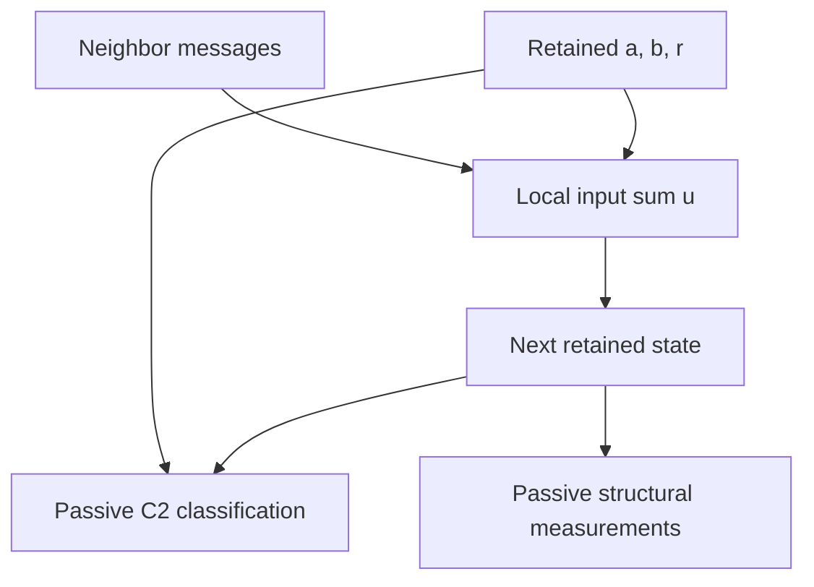
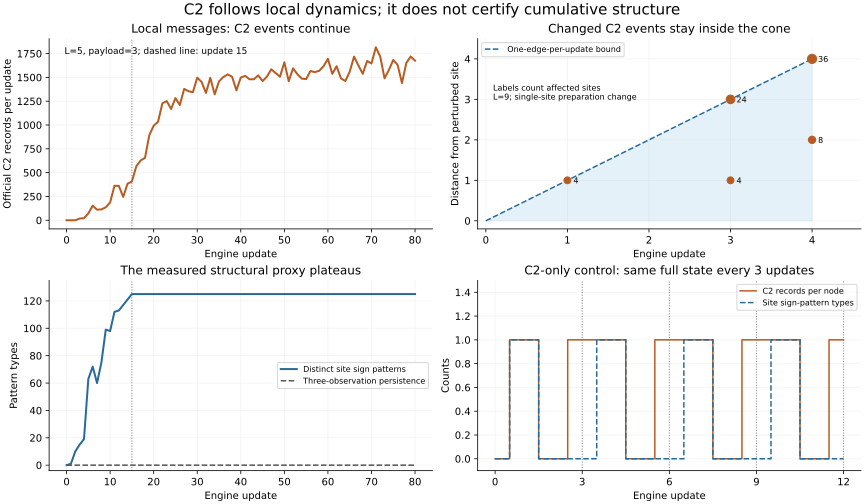

# C2, local communication and the forward cone

The main branch checked on 11 November 2026 is
`8d3f15074d3f9a9344ec587dbab0222243505187`: the 48-channel reference model.
The message transport in PR #29 and the audits in PR #30 are separate, unmerged
constructions. The main snapshot was run independently and its 80 complete
state hashes matched the explicit reference mode used by this audit.

**There is a forward causal bound for changes in C2 records. There is also a
measured causal path from local messages to later C2 records. The code and
controls do not establish that a C2 record creates cumulative complexity.**

## What the third class means

The three named classes are C0, C1 and C2. C2 is the third named class, not a
special third chronological event. Every gear uses the same update:

```python
ell, r_next = divmod(2*u + r, 6)
a_next, b_next = b, ell - a
```

Therefore `delta_r = (r_next-r) mod 6 = 2*u mod 6`. Integer transitions preserve
the parity of each remainder and can only have turns 0, 2 or 4:

| Input residue | Actual remainder turn | Class of an emitted record |
|---|---|---|
| `u mod 3 = 0` | 0 | C0 |
| `u mod 3 = 1` | 2 | C1 |
| `u mod 3 = 2` | 4, equivalently -2 | C2 |

An official record additionally needs `ell != 0`, a changed complete triple,
and an official observation label. A remainder turn can occur without an
official record when the quotient is zero. The remainder participates in the
next arithmetic update; the **class label** is calculated after the update
and never feeds the tensor. Renaming/counting a class does not add a force,
feedback link, future-path selector or stagnation detector.

## How communication reaches C2

An incoming prepared message M adds `3*M` to the local reference receiver's
input. For a fixed old receiver state, this has the exact effect

```text
u -> u + 3*M
ell -> ell + M
r_next -> r_next
b_next -> b_next + M
```

The immediate remainder turn is unchanged, although a previously absent
record may now appear because the quotient changed. In later updates, the
reference block reads the changed b with coefficients +1 or -1. Those later
input sums can change modulo three and produce C1 or C2. The packet lanes
themselves preserve their remainders and only emit C0 records.



There is no implemented arrow from the C2 label to structural growth. Any
future feedback must be realized in the retained local dynamics. An observer
callback that detects C2 and injects a pulse would be an additional law.

On the declared L=5 preparation, changing only the initial packet payload
changes the first official C2 update:

| Payload | First C2 update |
|---:|---:|
| 1 | 2 |
| 3 | 3 |
| 9 | 4 |
| No packets | None in 80 updates |
| Payload 3 with reception disconnected | None in 80 updates |

Thus C2 first appears on the third update in the current payload-three
example. That is a measured property of this preparation, not a universal
third-step clock. Disconnecting reception keeps the same travelling packet
seed but prevents the reference response, establishing a causal message path.

## The cone applies to events as well as states

A forward tensor term reads the target and at most one face neighbor from the
same old snapshot. If two complete preparations differ on a set S, induction
gives: after t updates their differing state values are within periodic
Manhattan distance t of S. A click at update t reads that site's before/after
triples, so changes in its presence, quotient or class obey the same bound.
There is no special faster or slower maximum cone for C2.

The paired L=9 run changes one reference `b` by 17. The counts of sites with
differing C2 records at updates 1–4 are `4,0,28,44`; every event stays inside
the bound, with maximum observed distances `1,None,3,4`. The complete state
and the full official event stream also have zero outside-cone differences.

A second control compares the prepared message pulse with the silent seed.
Its **complete** initial footprint includes the center b values and the six
neighboring old-a values. Using all seven sites, the changed C2 counts are
`0,0,18,22`, again with zero outside-cone differences. Omitting old-a from the
initial footprint would give an incorrect causality test. Both paired runs
rewind exactly.

This is a computational lattice cone, not a demonstrated Lorentzian null cone
from the evolving Einstein metric. A common operational metric for these
clicks and the separate ADM construction has not been established.

## What the actual structural measurements show

| Run | Updates | C0 | C1 | C2 | Structural result |
|---|---:|---:|---:|---:|---|
| Actual main reference pulse | 80 | 300 | 0 | 0 | Complete state returns every 16 updates |
| Communication pulse, payload 3 | 80 | 92,493 | 96,505 | 96,615 | Site/edge counts plateau at 125/375; no reference reassembly |
| Same messages, reception disconnected | 80 | 960 | 0 | 0 | Reference board stays empty |
| No messages | 80 | 0 | 0 | 0 | Entire preparation stays silent |
| Uniform C2-only control | 12 | 0 | 0 | 1,000 | Complete state returns every three updates |

In the communication run, the vector of site patterns, edge-pattern pairs
and three-observation persistence is `(125,375,0)` from update 15 through 80.
**94,043 more C2 records occur after update 15**, with no increase in those
proxies and no recurrent reference reassembly. The full state can still
change while finite structural diagnostics are saturated; these proxies are
not a complete definition of physical complexity.

Two exact counterexamples prevent a label-based causal overclaim:

- Main's first update increases nonzero site sign-pattern types from 1 to 6
  with only C0 records. A rise in this proxy is not exclusive to C2.
- The fixed one-gear law `u=2` has the cycle
  `(a,b,r): (0,0,2) -> (0,1,0) -> (1,0,4) -> (0,0,2)`.
  Its first and third transitions emit C2; the middle has zero quotient.
  Preparing it uniformly gives C2 records forever on an identical repeating
  complete state. No single-valued state complexity can strictly grow around
  this cycle. This is a control, not a proposed cosmology.



## Where the Einstein construction fits

The fixed-six port of PR #27 at `335eb3c1b625075dbcca01f9cd61faffdd614600`
was checked against the **same tensor fingerprint** as the previously executed
two-step dark-dust run. All 21,372 coefficients are multiples of three, with
gcd three. Consequently every input is a multiple of three for every integer
state: `r_next=r`, and every emitted record is C0. This is an algebraic
identity, not an extrapolation from a small C2 count.

The compiler can perform its declared geometry/matter calculation and retain
information while having no C2 records. Its copied per-node scheduling bank
also has no reference-to-clock feedback, as the
[separate review](EINSTEIN_UPDATE_REVIEW.md) records. The main reference model,
local-message proposal and finite Einstein compiler therefore do not yet
constitute one C2-driven, complexity-growing cosmological mechanism.

## Reproduce and inspect

```bash
OMP_NUM_THREADS=1 OPENBLAS_NUM_THREADS=1 python experiments/cosmology/click_cone_audit.py
python -m unittest universe24.tests.test_click_cone_audit -v
# Optional plot of saved measurements; Matplotlib is a rendering dependency.
python experiments/cosmology/plot_click_cone.py
```

The [evidence](evidence/click_cone_audit.json) includes pinned sources,
complete-input fingerprints, the independently executed main comparison,
modular/causal controls and exact-rewind results. The
[time series](evidence/click_cone_timeseries.csv) lists the measured counts and
proxies. Fresh runs additionally save each actual tensor and complete initial
and final states. All seven traces match an observation-free replay; all
rewinds are exact. Five focused tests cover signed and arbitrary-precision
inputs, official-event filtering, nonempty C2 cones, changed payloads, periodic
counterexamples and the all-multiples-of-three invariant.
