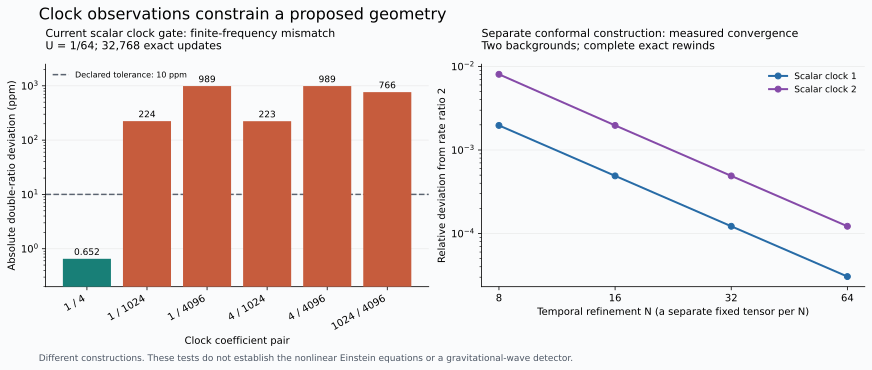

# Coupled clocks: an optional fixed-tensor research construction

This construction connects local oscillators, field multiplets and recording registers through a tensor chosen before the run. Every register still uses the same scalar Rule3 update. The construction provides exact algebra, reversible feedback and tests of information transfer. It does not establish gravity, quantum entanglement, cosmological bounces or a preference for increasing complexity.

The implementation is in [`clock_network.py`](../universe24/layers/clock_network.py), [`clock_bridge.py`](../universe24/layers/clock_bridge.py) and [`resolution.py`](../universe24/layers/resolution.py). These are optional builders, not a replacement for the default tensor or extra operations performed after an update.

## 1. One update, with a declared state and tensor

At storage node $x$, gear $g$ holds

$$
S_{xg}=(a_{xg},b_{xg},r_{xg}),\qquad
a_{xg},b_{xg}\in\mathbb Z,\quad 0\le r_{xg}<D,\quad D=6Q.
$$

Here $Q$ is one common positive integer. The input is a fixed integer polynomial, with at most three input factors:

$$
u_{xg}=\sum_m T_{gm}\prod_{j=1}^{d_m}
z_{x+\delta_{mj},h_{mj}},\qquad d_m\le3.
$$

A factor $z$ reads an old $a$ or old $b$, as declared in the tensor. Constant and lower-degree terms are allowed. “Order four” counts the output gear and up to three input factors; it does not mean that every term has degree four. The sole forward operation is

$$
(\ell_{xg},r'_{xg})=\operatorname{divmod}(2u_{xg}+r_{xg},D),
\qquad a'_{xg}=b_{xg},\qquad b'_{xg}=\ell_{xg}-a_{xg}.
$$

Euclidean division applies to negative inputs too. No floating-point integration, click callback or parameter adjustment is inserted during evolution. The fixed tensor, common divisor, geometry, labels and complete initial state are separate construction choices; Rule3 alone does not determine them.

For inputs depending only on old $b$, the inverse first recovers $b=a'$, then computes the old input and

$$
r=(r'-2u)\bmod D,\qquad
a=(2u+r-r')/D-b'.
$$

The division is exact. The general engine also permits an acyclic dependency graph of old-$a$ reads: the inverse reconstructs those registers in the validated order. All new clock terms read old $b$ only, so they do not introduce a cycle into that graph. Reversibility belongs to the complete network state; it is not a claim that a node can reconstruct its past without its required neighbor data.

The number of gears remains a model choice. The optional network adds one master and one clock per declared sector, seven gears for the default six-sector catalogue. The existing 48-component reference representation is one multiplet within the larger source tensor, not the total gear count of this construction.

## 2. What the clock network adds

Write $C_x$ for the local master clock and $c_{s,x}$ for a sector clock. They are ordinary $b$-registers, each with its own $a,r$. With integer free coefficient $\alpha$, master-sector spring $k>0$, and optional spatial spring $h\ge0$, the added clock inputs are

$$
\begin{aligned}
u_{C,x}&=\alpha C_x+k\sum_s(c_{s,x}-C_x)
                  +h\sum_{y\sim x}(C_y-C_x),\\
u_{c_s,x}&=\alpha c_{s,x}+k(C_x-c_{s,x})
                  +h\sum_{y\sim x}(c_{s,y}-c_{s,x}).
\end{aligned}
$$

The six spatial neighbors are the face neighbors. These are integer polynomial entries, not independent oscillator update laws. The default free coefficient is $\alpha=D/2$. An isolated such clock satisfies $b'=b-a$ and $r'=r$, hence returns after six updates; a coupled clock need not keep that period.

To couple a sector to a complete multiplet, declare full field components

$$
\phi_i=b_i+v_i,\qquad E=\sum_i w_i\phi_i^2,
$$

with integer shifts $v_i$, nonzero integer weights $w_i$, positive integer coupling $\lambda$, and counterterm $E_0$. The default counterterm is $\sum_iw_iv_i^2$. The algebraic potential

$$
\Phi_{\mathrm{port}}=-\frac{\lambda}{2}c_s^2(E-E_0)
$$

gives the added inputs

$$
\Delta u_{c_s}=-\lambda c_s(E-E_0),\qquad
\Delta u_i=-\sigma_i\lambda w_i\phi_i c_s^2.
$$

Here $\sigma_i\in\{-1,+1\}$ is the source gear's declared field sign, so the reciprocity convention is $u_i=\sigma_i\partial_i\Phi$. The potential is a certificate for these derivatives; it is not an established conserved physical energy. Its half-integer coefficients cause no issue because the implemented input coefficients are integers. The force is at most cubic, preserving tensor order at most four.

For a multiplet on one oriented link $(x,y)$, the builder uses

$$
\Phi_{xy}=-\frac{\lambda}{2}(c_{s,x}^2+c_{s,y}^2)(E_{xy}-E_0).
$$

Both endpoints receive their respective clock response; the link multiplet receives a force proportional to $c_{s,x}^2+c_{s,y}^2$. Every added monomial occupies one node or one physical edge. The builder separately checks that fact. It does **not** repair any broader physical support already present in the source tensor. `strict_support=True` checks the whole composition and rejects a source that fails the stronger single-edge condition.

A norm is invariant only under transformations preserving its declared quadratic form. The catalogue uses complete selected multiplets, the full shifted Higgs field, and optionally full shifted gauge-link fields. It excludes a Euclidean norm of electromagnetic potentials, which is not gauge invariant. Metric Frobenius weights express spatial tensor rotations, not Lorentz boosts. Negative weights are permitted algebraically and imply no positivity or stability guarantee.

The polynomial force-covariance tests are deliberately narrower than a theorem of covariance of the complete Rule3 transition. Affine backgrounds, field signs, other source couplings and the remainder transformation must also be checked. A signed permutation or spinor representation by itself does not establish quantum dynamics.

A structural dependency path permits information transfer but does not prove that a chosen seed activates it. For example, the response $-\lambda c_s^2\phi_i$ leaves an exactly zero, otherwise undriven multiplet at zero. Activating a port requires a declared preparation, not a state modification during the run.

## 3. Recording-sum feedback and passive clicks

The optional bridge joins a clock $C$ to scalar recording registers $p,m$, all with field sign $+1$, through

$$
\Phi_{\mathrm{bridge}}=-\kappa C(p+m),\qquad
\Delta u_C=-\kappa(p+m),\qquad
\Delta u_p=\Delta u_m=-\kappa C.
$$

This on-site reciprocal block adds only linear inputs. It enables a clock to respond to the recording **sum**, which contains information absent from the difference alone. Its fixed coefficients are selected before the run.

For a matched recording pair, suppose

$$
u_p=cIL_p-\kappa C,\quad u_m=-cIL_m-\kappa C,\quad
L_p+L_m=D/(2c),\quad r_p=r_m,
$$

with static integer loads and integer intensity $I$. Then $2u_p-2u_m=DI$, and exact division gives

$$
r'_p=r'_m,\qquad \ell_p-\ell_m=I,\qquad
\Delta a'=\Delta b,\qquad \Delta b'=I-\Delta a.
$$

The common force cancels from the difference, but changes each individual quotient ledger. Over $N$ updates,

$$
\begin{aligned}
D\sum_t\ell_{p,t}&=2c\sum_t I_tL_p-2\kappa\sum_t C_t+r_{p,0}-r_{p,N},\\
D\sum_t\ell_{m,t}&=-2c\sum_t I_tL_m-2\kappa\sum_t C_t+r_{m,0}-r_{m,N}.
\end{aligned}
$$

An earlier standalone load-fraction interpretation cannot omit the new common-force term. Quotient weight is also different from the number of click records. Even a conditional one-shot counting identity does not prove that successive recording tokens remain independent after feedback.

The official public click stream is a passive observation of two snapshots. An arithmetic event requires $\ell=b'+a\ne0$ and a changed triple $(a,b,r)$; the public stream additionally filters the tensor's gear labels to `official`. A raw quotient stream and an audit-labelled gear are not interchangeable with this stream. Event kinds $C0,C1,C2$ classify the signed remainder turn; they are not three successive causal stages or a collapse operation.

Thus the board state changes the next board state, and clicks reveal part of that change. The decoder never feeds a chosen event back into the board. “Selection” can mean that an initially encoded alternative ceases to appear in a specified readout while distinguishing information remains elsewhere. Erasing all distinguishing full-state information would contradict the inverse theorem. A claim of preference for greater complexity additionally requires a fixed objective and an independently tested dynamical result.

## 4. Exact resolution lift

For positive integer $M$, scale **every** source coefficient and the common divisor parameter:

$$
T_M=MT,\quad Q_M=MQ,\quad
E_M(a,b,r)=(a,b,Mr).
$$

Because

$$
\operatorname{divmod}\bigl(M(2u+r),MD\bigr)=(\ell,Mr'),
$$

the lifted baseline satisfies the exact intertwining identity

$$
W_{T_M,Q_M}E_M=E_MW_{T,Q}.
$$

Counters and quotients are unchanged; remainders scale by $M$. The same argument applies to validated old-$a$ inputs. The original preparation must be lifted explicitly, rather than recreated with a different vacuum formula at the new $Q$. Geometry, dependency order, tensor degree and support are unchanged. The embedding covers an invariant subset of the larger remainder space, not every new preparation.

Adding unscaled interactions afterwards defines a different candidate law. Coefficient one is then weaker relative to the baseline by $1/M$. Scaling an added interaction by $M$ as well preserves its relative strength and any existing instability. Resolution is a construction choice, not a derived physical scale or a repair of an unstable embedded orbit.

## 5. Stability has to be checked separately

For a symmetric linear, old-$b$-only input $u=Bb$, ignoring the remainder correction yields

$$
b_{t+1}+b_{t-1}=\frac{2}{D}Bb_t,\qquad
\cos\omega=\beta/D.
$$

An eigenvalue $\beta$ outside $[-D,D]$ gives an exponentially growing linear mode. Inside the interval, this calculation still does not control nonlinear terms, arbitrary drives, or accumulated remainder corrections. Defective matrices and the marginal endpoints need additional care.

For the isolated symmetric clock network with all field ports removed, a conservative spectral interval is

$$
[\alpha-2d_{\max},\alpha],\qquad
d_{\max}=k\,n_{\mathrm{sectors}}+6h.
$$

This is the builder's clock-block bound, not a bound on the composed system. The isolated free-clock/record-pair bridge has eigenvalues

$$
0,\qquad D/4\pm\sqrt{D^2/16+2\kappa^2},
$$

strictly inside $(-D,D)$ for $0\le\kappa<D/2$.

Small reciprocal coupling is not automatically safe. Coupling a free clock to a marginal uniform hand gives the illustrative matrix

$$
\begin{pmatrix}D/2&\eta\\\eta&D\end{pmatrix},
$$

whose largest eigenvalue exceeds $D$ for every nonzero $\eta$. Similarly, the metric stencil $u=(Q-1)\sum_6b+6b$ has checkerboard eigenvalue $-D+12$ on an even periodic lattice. An additional on-site shift $-\lambda C^2b$ can consume this small margin. Floating-point normalization by a large $D$ can hide its size. The exact resolution lift multiplies the absolute margin by $M$, while unscaled new couplings become relatively weaker.

Even the undisturbed integer stencil differs from its remainder-free spectrum. The [exact metric-source audit](METRIC_SOURCE_AUDIT.md) constructs a parity-uniform checkerboard with alternating amplitude $B+vn$ while the retained residues remain in an explicitly bounded interval. At $v=0$ it has exact period two; at $v=1,B=512,Q=2^{33}+1$ it grows linearly for over two billion provable updates. A million updates and inverses were actually run in the proved two-sublattice reduction, alongside a 32-update full-engine comparison. This is a lattice-corner preparation and does not refute every low-frequency limit. It shows why a continuum or spectral argument must state its allowed remainder phases, seeds and wave numbers.

For the spatial mean, the same audit proves the exact ledger $p'-p=2\sum_xJ_x$, where $p=D\sum_x(F_x-a_x)+\sum_xr_x$ and $J$ is the non-free input to the metric register. A static complete periodic geometry requires zero total source. A one-time background adjustment cannot cancel an arbitrary time-varying source. Growth of $h_{00}$ without a physical scale factor and Einstein constraints is not a demonstrated cosmological evolution.

There is also an exact large-amplitude obstruction. For the isolated scalar input $u=\beta b-\lambda b^3$, with $\lambda>0$, Rule3 gives

$$
b'=\frac{2\beta}{D}b-\frac{2\lambda}{D}b^3-a+\epsilon,
\qquad |\epsilon|<1.
$$

Consequently,

$$
|b'|\ge\frac{2\lambda}{D}|b|^3-
\frac{2|\beta|}{D}|b|-|a|-1.
$$

If $|a|\le|b|$, $|b|\ge1$, and $\lambda b^2\ge|\beta|+2D$, then $|b'|\ge2|b|$. Since $a'=b$, these conditions persist and define an escaping cone. A confining quartic potential in a continuous oscillator therefore does not prove boundedness of this discrete recurrence. Additional fields alter the full equation; this scalar theorem explains a failure mechanism rather than classifying every coupled orbit.

## 6. Evidence and reproducible acceptance conditions

The following are finite preparations and horizons, not global stability claims. A guard stops after an observed counter exceeds its declared bit limit; it neither clamps nor repairs the state. A cubic update can overshoot that limit. “Counter bits” here measures $a,b$, not the fixed-size remainder range.

| Experiment | Observed result | Scope |
| --- | --- | --- |
| Isolated bridge regression, $Q=17,\kappa=12$, 1000 updates | Two seeds differing only in the shared pair remainder change the records on update 1 and the clock on update 2; pair lock, revised ledger and exact rewind pass; counters remain below 64 | Actual local feedback for this fixture; with $\kappa=0$, the clock histories coincide |
| Default $L=3$ `jpure` preparation, requested 5000 updates | Growth guard reached at update 2192, peak 485 counter bits; exact rewind passes | Reversibility survives loss of the intended bounded regime |
| Exploratory component-star couplings, weaker and stronger cases | Guard reached at 1207 / 468 bits and 685 / 412 bits respectively; exact rewind passes | Structural integration and extra clicks do not establish stability or covariance |
| Unchanged baseline tensor; only initial matter $a,b$ divided toward zero by 16 | $L=3$ completes 20,000 updates, peak 26 counter bits; $L=4$ completes a retained 46,000-update prefix, peak 29 bits; both exactly rewind | A finite-horizon preparation; the requested 100,000-update run was resource-stopped, metric drift persists and several unseeded sectors remain dormant |
| Full norm-clock network with recording bridge, spring $D/64$ | $L=3$ and $L=4$ each complete 5000 updates and exactly rewind, peak 25 counter bits | One connected dependency component and measured reciprocal transfer; not global stability |
| Held-out preparations, same candidate tensor, $L=3$ | RNG seeds 17, 31 and 47 each complete 5000 updates and exactly rewind, peak 25 bits | Robustness across these preparations, not arbitrary seeds |
| Initially decorrelated clock phases, same tensor, $L=3$ | 5000 updates and exact rewind; phase order falls from 0.11086 to 0.02214, whereas aligned preparation retains 0.96481 | No spontaneous synchronization in this comparison |
| Activated reference packet, $L=4$ | 5000 updates and exact rewind; all 48 reference channels active; peak $|h_{00}|/(2P)=0.090517$ | Actual reference-sector transfer, with growing geometry rather than a stationary gravitational solution |

The bridge fixture is executable in [`test_clock_bridge.py`](../universe24/tests/test_clock_bridge.py). Network tests in [`test_clock_network.py`](../universe24/tests/test_clock_network.py) compare expanded inputs against the signed potential derivatives, check support and inverse recovery, and test the limited polynomial covariance claim. [`test_resolution.py`](../universe24/tests/test_resolution.py) checks the exact lift.

The [long-run evidence](evidence/clock_long_runs.json) records the audited default, rejected and quieter preparations, with actual horizons, exact state hashes and inverse results. The [connected-clock evidence](evidence/connected_clocks.json) adds preparation recipes, counter bounds and paired controls. The executable preset is [`connected_clocks.py`](../universe24/tools/connected_clocks.py). It scales the baseline by $M=2^{28}$, divides only the initial matter counters by 16, prepares the seven local clocks explicitly, and adds the fixed ports and recording bridge before evolution. The runtime never tunes these choices. An even resolution lift preserves the embedded dynamics but does not inherit the original odd-divisor seed's mirror claim.

In the forward $L=4$ control, a shared detector-token perturbation changes official matter quotients by update 166 and gauge quotients by 244. In the reverse $L=3$ control, a matter-only perturbation reaches the original reader quotient at update 336, the detector difference at 337 and the original large-hand counter at 338. The exact witness records reader intensities 53,681 and 53,264, followed by the same difference of 417 in the detector response. A zero-bridge control removes the cross-sector transfer. Record-kind changes, quotient changes and event-presence changes are reported separately. These tests show feedback in the selected model; they do not identify a preferred future, a quantum measurement or gravitation.

The [strict-support composition](evidence/strict_clock_composition.json) adds 90 mediators: 479 total gear types, rank four and zero single-edge support violations. Weak coupling gives physical-link remainder response and exact finite-horizon rewind, but no corresponding link-counter response within the 300-update observation. Stronger mediator springs exceed the near-marginal wave stencil's stability margin. A separate [wave-margin experiment](evidence/strict_wave_margin.json) reserves margin on ten metric and three electromagnetic registers; its 1000-update $L=4$ histories exactly rewind with 25-bit counters and genuine link-counter response. However, the inherited Lorenz constraint evaluated on the physical links fails from update two. A constraint passing on projected mediator fields is a different readout and does not establish equivalence of the link physics. This exploratory adjustment is not a production option or a default change.

To claim actual cooperation between sectors, predeclare a source perturbation, target official gears, tensor fingerprint, seed, lattice, horizon and readout. Run two preparations differing only at that source, with the same frozen tensor. Require a target **official-record** difference, no difference before causal arrival, and a zero-added-coupling control. If reciprocal response is claimed, reverse the source and target. A connected dependency graph and two correlated clocks are weaker evidence.

Store non-event update slots as well as events. For a storage-neighbor-local forward law, an initial disturbance cannot cross more than one face edge per update. Test this against the actual tensor dependencies and periodic geometry; a link's physical endpoints and its storage site are distinct locality conventions.

## 7. Crossings, recurrence and complexity

A sign crossing of a clock hand, a minimum distance from the initial $b$-array, and a return of the full $(a,b,r)$ state are different events. Compare epochs between same-direction crossings and retain both crossing orientations. Do not reset or reseed at an epoch boundary. The public [`clock_epochs.py`](../universe24/tools/clock_epochs.py) checks full-state recurrence after every completed update; reports based on sampling alone must use the narrower sampled claim.

The unstable default control exhibits repeated hand crossings and coarse echoes before its counter growth. Those markers do not reset the other fields. A cosmological bounce requires an operational geometry or scale factor, demonstrated contraction and expansion, and appropriate source and curvature equations; naming a crossing a “bang” supplies none of these.

For click organization, fix a finite alphabet, windows and lags before comparing candidates. A useful initial diagnostic is the sign of the summed signed official quotients in each sector at each update, accompanied by event rates and event-kind proportions. Measure symbol entropy, temporal and cross-sector mutual information, repeated patterns and persistence. Compare shuffled marginals and circularly shifted series; these controls are descriptive unless a valid statistical null has also been specified.

Perfectly periodic synchronized clocks can have high mutual information and little structural complexity. Independent noise can have high entropy and little predictive organization. Counter magnitude, bit length, total click count and a single correlation therefore cannot certify greater organized complexity. The exploratory long-run controls have not demonstrated increasing predictive organization.

There are two exact limits on a universal complexity preference:

1. On a finite invariant state set, reversibility is a permutation of cycles. If $C(Ws)\ge C(s)$ for every state, summing around any cycle forces equality at every step. Strict improvement throughout a nontrivial cycle is impossible. The complete integer model is unbounded, but any indefinitely bounded orbit on a finite board has only finitely many possible full states and is periodic.
2. For a probability distribution on full states, a bijection preserves Shannon entropy whenever that entropy is finite: $H(W_*p)=H(p)$. An observed subsystem can become more ordered through correlations, information retained elsewhere, or export to another subsystem. Coarse entropy can change. This is not a theorem that every unbounded reversible trajectory has a constant complexity measure.

To interpret such behavior thermodynamically, define macrostates, their measure, and physical energy or heat bookkeeping. Neither the remainder ledger nor a growing counter has already been identified with temperature. A proposed selection mechanism should retain reversible records of alternatives and demonstrate persistent, locally observable organization under controlled preparations.

## 8. Gravity means a shared metric measured by clocks and signals

The gravitational target is a dynamical geometry experienced by matter and signals. An extra attraction between oscillator amplitudes would not establish that target. The underlying board supplies local causal dependencies; an effective spacetime metric must be reconstructed from operational clock and propagation measurements and then predict further observations. Click records can report those measurements without themselves creating a metric.

The present code already contains a **candidate geometric coupling**, distinct from the optional norm-clock portal. In [`gravity_l0c.py`](../universe24/layers/gravity_l0c.py), a scalar field $F=\texttt{metric.h00}$, with $U=F/(2P)$, multiplies the reference multiplet's rest matrix by $1-F/P$, and its spatial difference transport on $(x,y)$ by $1-(F_x+F_y)/P$. The reciprocal potential also supplies a source for $F$. For a uniform prescribed field, the exact remainder-free reference dispersion at rest obeys

$$
\frac{\sin(\omega(U)/2)}{\sin(\omega(0)/2)}=\sqrt{1-2U}.
$$

At finite rest frequency this is not an exactly universal dilation of the actual click-cycle period. Expanding at small $U$ gives

$$
\frac{\omega(U)}{\omega_0}
=1-\frac{2\tan(\omega_0/2)}{\omega_0}U+O(U^2).
$$

The coefficient approaches one at low frequency but depends on the mode otherwise. First-order matter read around its $\pi/2$ carrier likewise has an envelope frequency $\delta(U)=\arcsin[(1-U)\sin\delta_0]$, with a mode-dependent finite-frequency correction. A common geometric lapse therefore needs a declared scaling limit and error bounds, not just equal factors in the input polynomials.

The corresponding gapless branch, when present, has a changed propagation speed. The default handed reference multiplet is gapped and audit-labelled, so a test using the alternative gapless sign class is not automatically a default official-photon result. [`matter_lapse_c.py`](../universe24/layers/matter_lapse_c.py) similarly distinguishes a first-order matter rest term from spatial transport. The full chiral and electroweak composition must still satisfy the same physical interpretation; the name “universal lapse” in a builder is not a completed universality test.

The optional [`einstein.py`](../universe24/layers/einstein.py) extension is **not included by `one_system()` by default**. It supplies a signed DeWitt basis and reciprocal diagonal-stress coupling for the reference multiplet. Its tests verify exact basis identities and reader coefficients. They also verify that the mixed $h_{0i}$ and spatial off-diagonal $h_{ij}$ gears have only their free stencils, without matter readers or sources in that extension. A two-polarisation count imposes a null-wave and harmonic-constraint ansatz; it does not show that the interacting board enforces those constraints. The source-divergence diagnostic in [`observe/einstein.py`](../universe24/observe/einstein.py) exposes a conservation defect instead of an enforced Einstein/Bianchi system.

Other gaps are explicit in [`universality.py`](../universe24/layers/universality.py): the proposed fully gauge-covariant transport dressing is not integral at the default coefficients, while the photon metric read has a nonuniform-field Gauss defect. The default source and the clock-network construction therefore do not yet define one operational metric shared by every field and clock. Direct rank and locality obstructions in these builders concern the specified representations and monomials; they are not a proof that every possible encoding with auxiliary registers is impossible.

The added clock-network norm port contributes terms such as $-\lambda c^2\phi_i$, changing local oscillator stiffness. It does not supply the same rest/transport metric dressing, general shift response, geodesic equation or Einstein source equation. The record-sum bridge supplies feedback, not gravitation. A spatial spring changes clock transport, but merely giving it nearest-neighbor support does not make it a geometric metric coupling.

Existing gravity evidence also uses different observables. The `d1_clocks` demonstration reads arithmetic click sign cycles in a prepared static-load setup, then applies the stated sine-frequency calibration. The Einstein `bending_shapiro` demonstration estimates arrival times from a quadratic expression in board $a,b$; that is a board diagnostic, not an official-click-only measurement. Stored optional-universality results fail their original raw rest-clock tolerance; their closer input-corrected diagnostic is labelled post hoc. These distinctions must survive any comparison or claim about observed physics.

A new reproducible gate uses four existing scalar lapse clocks and a uniform background maintained by its own Rule3 law. It is a prescribed-background test-body construction, not `one_system()` or a self-generated metric. All clocks have identical initial counter values; only the background value changes between preparations. The primary quantity is the dimensionless double ratio

$$
R_{AB}(U)=\frac{\omega_A(U)/\omega_B(U)}{\omega_A(0)/\omega_B(0)}.
$$

The computational tick unit cancels, and common dilation predicts one. Official-click sign cycles determine the raw frequencies. At $U=1/64$, the lowest/highest-frequency comparison gives $R-1=0.000989328$, failing the declared $10^{-5}$ tolerance. The two lowest-frequency clocks give $R-1=0.000000652$, passing the same tolerance. The other nonzero backgrounds show the same distinction. All four preparations complete 32,768 updates with exact rewind, a static background and peak 25 counter bits. The sine-transformed diagnostic agrees within $1.23\times10^{-8}$ but does not rescue the failed raw-clock comparison.

Run `python -m universe24.tools.metric_clock_gate --out runs/metric-clock-gate/report.json`. The [committed evidence](evidence/metric_clock_gate.json) includes every preparation, all six clock pairs, raw rates, state hashes and provenance; [focused tests](../universe24/tests/test_metric_clock_gate.py) verify the reader and acceptance distinctions. The public tool reruns every case without a cache. It confirms a finite-frequency limitation and a tested slow-clock regime, not complete equivalence-principle compliance. Slowing the clocks requires smaller actual mode frequencies; the exact resolution lift alone preserves their frequencies and cannot remove this effect.

The right panel uses a different, explicitly chosen [conformal scalar tensor](CONFORMAL_METRIC_EXPERIMENT.md). Its convergence is not a correction of the left panel's tensor or a completed Einstein derivation. The figure reads the committed reports directly; regenerate it with `python experiments/geometry/plot_summary.py` after installing the optional plotting dependency `matplotlib`.

Two further isolated constructions separate exact geometry from operational coupling. The [integer curl waves](LINEAR_SPIN2.md) have an all-time bounded travelling sector, and a separate two-bank control proves exact slower propagation. The [local metric experiment](PHASE_METRIC_EXPERIMENT.md) reconstructs a travelling perturbation with exactly vanishing linearized lattice Ricci tensor and constraints. Its fixed rank-four test-body probe changes official records, but the chosen probe and metric pattern have different speeds and no reciprocal stress coupling. These results are building blocks from different declared tensors; they have not been combined into one universal Einstein geometry.

The next geometric test should use the following fixed protocol:

1. **Reconstruct geometry.** Declare several independent rest-clock preparations and exchanged signal pulses with local official-event emission and detection rules. Infer relative clock rates and travel times from these records. In a static isotropic region, fit a common form $ds^2=-N^2dt^2+A^2d\mathbf x^2$: rest clocks determine $N$, and null travel determines $N/A$. This restricted fit is not a reconstruction of an arbitrary metric.
2. **Test the same geometry.** Fix the calibration and inferred metric, then predict held-out clock species, packet frequencies, directions and locations. Check that one Lorentzian metric describes them within declared lattice and remainder errors. A separate outcome-fitted time conversion for each species would conceal nonuniversality. The board's maximum dependency speed and the long-wavelength signal cone must be reported separately.
3. **Test free motion.** Track localized, freely propagating click packets without externally imposed trajectories. Their centres must follow the same inferred timelike or null geodesics in the applicable approximation; changes of composition should not require a new metric. Compare redshift, travel delay, deflection and tidal separation, including a zero-source control.
4. **Test dynamics of geometry.** Infer the source and curvature independently and test a declared approximation to $G_{\mu\nu}+\Lambda g_{\mu\nu}=8\pi G T_{\mu\nu}$, together with the relevant constraint and conservation equations. Fitting a metric is a kinematic achievement; it is not yet a derivation of Einstein's field equations. Linear weak-field agreement should be reported as such before attempting strong fields or cosmological bounces.

The minimum construction work is therefore to make existing metric readers cover the intended complete clock and transport representations consistently, or exhibit an equivalent local encoding that does so. It is not to add an unrelated attractive force. All of that work remains subject to fixed tensor order, integer coefficients, validated support and the same reversible Rule3 engine. General-relativity definitions and the separation of geometric, equivalence-principle and field-equation tests can be compared with Carroll's [author-written lecture notes](https://arxiv.org/abs/gr-qc/9712019) and Will's [review of relativity tests](https://arxiv.org/abs/1403.7377); they do not supply the missing derivation for this automaton.

## 9. Correlation does not establish quantum entanglement

For a Bell test, declare source trials, independent local settings $x,y\in\{0,1\}$, local detector windows and an outcome for every trial. No-click and double-click trials must be handled by a rule fixed beforehand or by an appropriate inequality. Do not select coincidences or discard trials using remote settings or outcomes. Both remote settings must be outside the respective output's causal past according to the actual board dependencies.

Under local deterministic response and a setting-independent source distribution, the outcomes have the form $A_x(\lambda),B_y(\lambda)\in\{-1,+1\}$. For each source state,

$$
A_0(B_0+B_1)+A_1(B_0-B_1)\in\{-2,+2\}.
$$

Thus the all-trial CHSH quantity satisfies

$$
|E_{00}+E_{01}+E_{10}-E_{11}|\le2.
$$

Adding clocks, local reciprocal couplings, quaternion representations or complex integer encodings does not change this proof. Timelike communication, setting-dependent source preparation, postselection or nonlocal readout change its assumptions and must be identified explicitly. No-signalling marginals alone do not certify a valid Bell violation. A numerical test must also report setting-conditioned detection rates, local marginals and uncertainty appropriate to possible device memory.

There is a useful but limited quantum representation: a reversible map defines a unitary permutation $U_W|s\rangle=|W(s)\rangle$ on the full-state basis. A classical basis seed still evolves into a basis seed. A classical mixture remains diagonal and is a mixture of product basis states, hence separable. Coherent superpositions and non-diagonal measurements can make a permutation act as a quantum gate, but that additional state and observation structure has not followed from the classical click decoder. A spinor transformation law and quantum entanglement are separate claims.

## 10. Primary literature and what can be transferred

These sources motivate precise constructions and tests. None proves that the present fixed tensor reproduces all physical laws.

| Primary source | Relevant lesson and limit |
| --- | --- |
| Toffoli, Capobianco and Mentrasti, [When—and how—can a cellular automaton be rewritten as a lattice gas?](https://arxiv.org/abs/0709.1173) | Reversible CA can admit signal-routing presentations under the stated CA assumptions. Applying finite-alphabet results to unbounded integer registers needs an explicit finite encoding or a separate proof. |
| Margolus, [Universal Cellular Automata Based on the Collisions of Soft Spheres](https://arxiv.org/abs/0806.0127) | Explicit reversible collisions implement reusable logic and routing. A Rule3 clock, delay, switch or collision gate needs its own verified embedding; universality of another automaton does not transfer automatically. |
| D'Souza and Margolus, [A thermodynamically reversible generalization of Diffusion Limited Aggregation](https://people.csail.mit.edu/nhm/ra.pdf) | A concrete reversible model couples aggregation and evaporation to a heat-token reservoir. It demonstrates how local organization and entropy transfer can coexist with reversal, but does not supply a Rule3 energy law. |
| Hampton and Zanette, [Measure Synchronization in Coupled Hamiltonian Systems](https://doi.org/10.1103/PhysRevLett.83.2179) | Conservative systems can coordinate invariant measures without dissipative convergence to identical trajectories. The current recurrence has not thereby been proved Hamiltonian. |
| Smith and Ahmadi, [Quantizing time: Interacting clocks and systems](https://quantum-journal.org/papers/q-2019-07-08-160/) | Relational clock readings motivate comparing subsystem histories. Their construction assumes quantum states, a Hamiltonian and conditional quantum dynamics that have not been derived here. |
| Bennett, [Logical Reversibility of Computation](https://doi.org/10.1147/rd.176.0525) | Reversible computation retains or reversibly uncomputes intermediate information; rejecting an observed route need not erase its full history. |
| Crutchfield and Young, [Inferring Statistical Complexity](https://doi.org/10.1103/PhysRevLett.63.105) | Predictive organization differs from randomness or raw entropy. The finite-window diagnostics above are not a reconstruction of the paper's causal-state complexity. |
| Bell, [On the Einstein Podolsky Rosen paradox](https://doi.org/10.1103/PhysicsPhysiqueFizika.1.195), and Clauser, Horne, Shimony and Holt, [Proposed Experiment to Test Local Hidden-Variable Theories](https://doi.org/10.1103/PhysRevLett.23.880) | The locality and setting-independence assumptions impose the operational inequality derived above. |
| Hensen et al., [Loophole-free Bell inequality violation using electron spins separated by 1.3 kilometres](https://arxiv.org/abs/1508.05949) | Event-ready trials, separated settings/readout and memory-aware statistical analysis are concrete experimental controls, not properties supplied by a correlated simulation. |
| Schumacher and Werner, [Reversible quantum cellular automata](https://arxiv.org/abs/quant-ph/0405174), and Arrighi, [An overview of Quantum Cellular Automata](https://arxiv.org/abs/1904.12956) | Quantum automata retain a quantum state and observable algebra in addition to locality and reversible evolution. Quantizing a classical permutation is not equivalent to deriving quantum measurements from its classical trajectories. |

The connected-clock controls establish finite-horizon reciprocal influence between official click streams with exact rewind. They do not establish persistent organization beyond prepared periodic agreement. Separately, the [bounded-circuit construction](BOUNDED_CIRCUITS.md) proves all-time boundedness, transmission and reflection on a specially prepared Boolean invariant sector of Rule3; it is not the interacting field model. The remaining integration milestone is to retain useful communication and boundedness while demonstrating organization under held-out preparations and longer horizons. Gravity, cosmology and quantum measurement each require their own operational observables and equations beyond that milestone.
