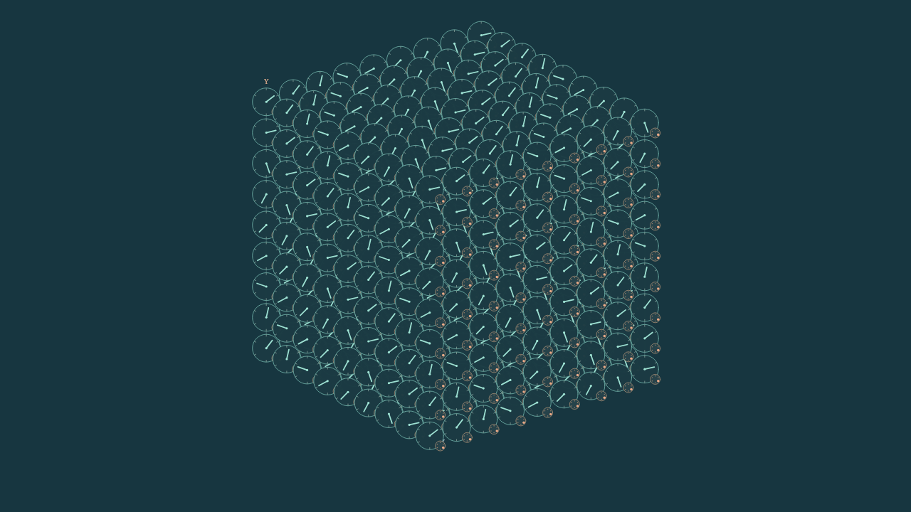

# Clock and signal building blocks

The current code assembles compatible initial states, runs the unchanged Rule3
engine, and displays complete recordings as clocks and gears. The recipes do
not install runtime behavior. One board, 48 channels per node, six neighbors,
`num=den=1`, synchronous updates and the tensor fixed before startup remain the
model contract.

## Available interfaces

| Interface | Code/API | Supported environment and evidence |
|---|---|---|
| Quiet prepared oscillator | `research.clock_selection.quiet_clock.QuietClock` | All eight existing sign tensors and all 48 channel labels; nonzero integer center with `abs(a)+abs(b)<=2`, residue 0..5 and a compatible complete halo. Exact isolated period-four theorem; 48 registered native cases independently replayed. Additional input requires a new interaction test. |
| Guided mobile carrier | `research.components.GuidedPacketSource`, `GuideSegment` | Exact +X translation on the prepared periodic guide under `+++`; full guide, packet and transverse remainder halo are required. This is a board signal, not established physical light. |
| Passive receiver and paired route | `research.components.Receiver`, `PairedArm` | Data-only patches. The registered `+++` O/N/R geometries have finite response evidence; constructor parameters alone do not guarantee memory or routing. |
| Signal-written clock phase | `research.staged_blocks.recipes.phase_assembly` | `+++`, sides 129/161, residues 0/4, four initial phases and delays 1/2/3/5. A carrier changes an already running clock's phase; the full target/reference regions retain the relative phase at states 32–40. |
| Prepared state-dependent transmission | `research.staged_blocks.composed_recipes.effective_coupler` | `+++`, sides 137/193, delays 4/5/8/9, `enable` or `aligned_suppress`. All four controls and a complete outgoing-carrier template are defined. |
| Scheduled pause and restart | `research.staged_blocks.composed_recipes.two_lane_pause` | `+++`, sides 129/161, delays 0..3. Two initially prepared packet trains stop and restart a clock. The surrounding region remains driven; this is not autonomous waiting for computed approval. |
| Earlier writer, later probe | `research.clock_selection.search_v2` | Research experiment producer, not a general component factory. Under `+++`, four accepted groups at sides 337/353, phase 0, gaps 36/38 show suppressed/enabled exact probe carriers. Only eight of 32 clock-on groups had valid registered inputs. |
| Conditional carrier to a terminal clock | `research.clock_selection.carrier_memory` | Research composition under `+++`, sides 393/425, four receiver phases and all four source masks. All terminal regions are quiet at states96–112. The phase0 writer-armed toggle changes the later record, but the joint result aliases the empty/probe-only controls; no unique joint-history record is obtained. |

The composer checks the complete tensor, board, background, time and overlapping
channel assignments. Conflicting halos are rejected rather than overwritten.
Two compatible preparations may coexist without interacting; a connection
needs complete input/output controls and a new behavioral check. See the
[assembly API](../research/staged_blocks/recipes.md) and
[component contracts](COMPONENTS.md).

## Assemble and run

From the repository root, restore the published evidence before reviewing saved
examples or running the full test suite:

```sh
python -m research.experiments.materialize_evidence
python -m research.clock_selection.archive materialize
python -m pip install -r research/clock_selection/requirements.txt
```

Create a fresh output directory for each run:

```sh
python -m research.staged_blocks.run list
python -m research.staged_blocks.run demo --output runs/four-components
python -m research.staged_blocks.run study recipes --output runs/phase-components
```

The reusable recipes return ordinary initial-state data and native experiment
specifications:

```python
from research.staged_blocks.composed_recipes import effective_coupler

assembly = effective_coupler(side=137, delay=4, family="enable", control="11")
prepared = assembly.prepare()
spec = assembly.experiment_spec(identifier="prepared-coupler", steps=40)
```

No component function is called by the engine during evolution. To reproduce
the complete new writer/probe family, use
`python -m research.clock_selection.search_v2 --output runs/write-probe`.
That command executes 260 registered controls and preserves failures. The
[research guide](../research/clock_selection/README.md) links every protocol,
budget, result and independent certificate.

The new isolated clock uses the same existing Patch composer:

```python
from research.components import BoardSpec, TensorSpec, finalize, place
from research.clock_selection.quiet_clock import QuietClock

tensor = TensorSpec.from_signs((1, -1, 1))
clock = QuietClock(channel=17, a=1, b=1, r=3,
                   halo_parity=1, tensor=tensor)
prepared = finalize(BoardSpec(7, tensor=tensor), [
    place(clock, at=(3, 3, 3), name="clock"),
])
```

Run its complete registered controls with
`python -m research.clock_selection.quiet_clock --prepare --output runs/quiet-clock`,
then `python -m research.clock_selection.quiet_clock --run --output runs/quiet-clock`.
The [clock report](../research/clock_selection/quiet_clock_results.md) links the
48 saved runs, six Presenter examples and the independent audit.

## What the results mean

The [claim register](../research/clock_selection/claim_register.md) separates
mathematical proofs, bounded computational results, hypotheses and future
targets, with their exact evidence links.

**Proved:** the scoped quiet-oscillator construction, full-state reversibility,
and the coherent all-channel wave reduction have mathematical arguments with
explicit assumptions. The planar-profile corollary gives an exact translating
periodic sheet; it does not identify a localized photon.

**Observed in finite registered domains:** a carrier can write a retained phase
and thereby change a later carrier's transmission. Independent preparation
crosses locate this influence in the complete seven-node clock region. In V2
the clock is already oscillating before either packet arrives. The separate
[36-run direct-activation study](../research/clock_selection/activation_results.md)
finds genuine transient activity in resting centers, but zero of18 matched
pairs leaves a quiet clock during the registered hold64–80. Its complete states
and negative criteria pass independent replay. All controls remain available,
including invalid incoming-carrier cases in V2.

The [64-run route/clock composition](../research/clock_selection/route_clock_results.md)
does activate resting centers: the early route winner produces its first C1
activation at update15, while the nominal losing side activates at59. All
registered quiet-memory targets fail. This is evidence of internal causal
influence, with a concrete limit on the joined component's retention.

A later [two-stage composition](../research/clock_selection/carrier_memory_results.md) supplies a complete conditional carrier to a
second clock. Its32 audited runs leave quiet terminal regions, and the phase0
examples distinguish writer-plus-probe from writer alone. However, the joint
terminal region equals the empty and probe-only regions in every tested
geometry. This finite writer-armed toggle does not retain a unique joint record
or compute approval.

Reading can change the record: the V2 phase differs before the probe at state
40, but the displayed clock states agree after the interaction at state 61.
This is not a nondestructive permanent latch. In the selected paired histories,
an [independent location check](../research/clock_selection/evidence/independent_audit/phase_record_information_location.json)
finds 48 differing triples outside the now-equal clock region at states 61 and
88. The exact inverse reconstructs the distinct inputs from the complete
counter/remainder field; local phase agreement does not erase information in
the rest of the board. These difference counts are not entropy or bit counts.

**Still unproved:** autonomous approval, indefinite reusable memory, a general
preference for complex routes, physical photons, quantum measurement and
entanglement, or gravitational/other physical forces. The older prepared OR/NO
route experiment does have a finite one-outlet winner. It does not establish
property-based preference: the fixed `C_pair` complexity test retained ten
eligible comparisons and ten counterexamples. In the new two-outlet family,
six sequential history-conditioned gates enable or suppress the exact Y carrier.
Separate simultaneous-input cases produce zero or two accepted carriers, never
one. No redirected output is established. Raw arithmetic C can occur even
without the accepted carrier, so it cannot be relabeled as approval.

Longer runs also supply limits. Complete joint states close after 50 or 54
updates in two periodic preparations. Following the other two sizes through
32 return opportunities found no regenerated registered carrier after loss.
An exact cycle repeats its state rather than accumulating new attempts.

## Fundamental rule and effective ratios

The selected model keeps `num=den=1` at every site and channel. Per-channel
coefficients will not be implemented in this research line. A ratio such as
`1/2` or `2/3` must instead be derived from a specified invariant pattern or
measured behavior under the same scalar rule, with its assumptions stated.

The [invariant-pattern follow-up](../research/invariant_families_v1/README.md)
does this for four globally prepared patterns under `+++`: the uniform pattern,
two spatial periodic patterns and one internal channel pattern. Their exact
operator eigenvalues give effective homogeneous ratios `1`, `1/2` and `2/3`
through a full scalar-state correspondence. All 48 registered preparations
pass independent replay, including odd remainders, all native C events and
complete rewinds. The [separate claim addendum](../research/clock_selection/invariant_families_claims.md)
states the proof assumptions and finite test domain. These whole-board sectors
are not localized building blocks, and the ratio is not a universal period or
a measured mass. The [nine-example viewer](../research/invariant_families_v1/evidence/presenter_combined_v1/index.html)
shows five complete family recordings and all four controls from a separate
[overlap study](../research/invariant_families_v1/overlap_results.md). That study
verifies the predicted first-step nonlinear carry between two global initial
patterns; it does not establish a localized encounter or retained detector
record. All 147 saved states use the unchanged Presenter.

A [corollary of the exact encoding](../research/clock_selection/invariant_sector_limit.md)
limits formation claims: its full-board sectors are invariant in both time
directions and cannot be entered from an outside full state. Localized,
approximate or coarse patterns with information elsewhere are not excluded.

The earlier
[mathematical proposal](../research/clock_selection/fixed_ratio_candidate.md)
defines how positive rational coefficients could be fixed at each site/channel
before startup while retaining an explicit inverse. That alternative is
unselected and retained as a mathematical comparison only. Nonunit coefficients change
the model contract; denominators above1 also enlarge the remainder domain.
It is a separate candidate with no implemented
engine, experiment or Presenter support here. A coefficient fixed to a lattice
location is not automatically a transported object's mass. The
[mass-family tests](../research/clock_selection/physics_targets/mass_families.md)
state the additional operational requirements. Effective measured ratios in
baseline experiments are also distinct from changing the microscopic rule.

## View the complete cube

The newer [combined recording inventory](../research/invariant_families_v1/evidence/collection_v1/index.html)
adds the two independently audited invariant/overlap studies: 17 studies,
140 complete selected examples and 22,110 saved states. The full evidence now
contains 942 complete recordings. The original inventory below remains intact.

Open the [final recording inventory](../research/clock_selection/evidence/presentation_collection_v3/index.html):
15 studies,131 complete selected experiments and21,963 saved states. The full
890-record research evidence and all controls remain available separately.

The [recording guide](../research/clock_selection/README.md#completed-evidence-and-its-limits)
lists the unchanged Presenter packages. Start a local server from the repository
root with `python -m http.server 8000`, open the linked inventory in a
JavaScript-enabled browser, choose an experiment, then Play/Step and drag to
rotate. Reset view restores all eight cube corners. A narrow guide occupies a
line inside the full cube; the dense coherent-wave recordings occupy its volume.

The Presenter is passive and shows all 48 channels, exact states and raw C.
Attachment previews may not execute JavaScript. Recorded JavaScript/Canvas
checks pass, but a native Chromium launch failed before loading the page;
Safari/iPad interaction is not certified. The wave comparison itself passes
independent replay, while its producer exceeded the registered CPU budget by
28.943 seconds. Scientific predicates, resource compliance and UI checks are
reported separately.



This is a native Canvas rendering of a saved dense periodic preparation. The
interactive recording retains all48 channels and can be rotated; the image is
not a browser-layout or physical-particle validation.

The [complete native pause/resume clip](../research/clock_selection/evidence/animations_carrier_memory/carrier-pauses-restarts-clock.gif)
shows the terminal clock stop at74, remain still at75 and restart at76. It
contains all121 saved states. The final joint clock still aliases null/probe-only;
the clip demonstrates finite native rewriting, not an approval mechanism.
