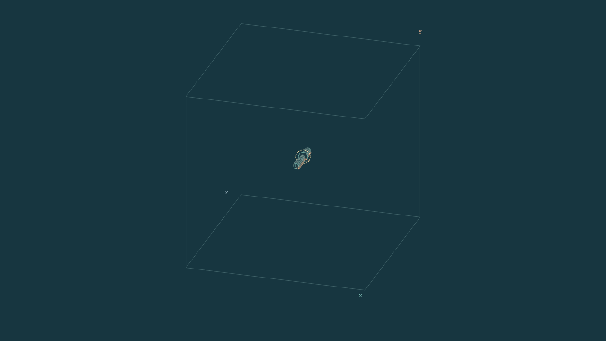
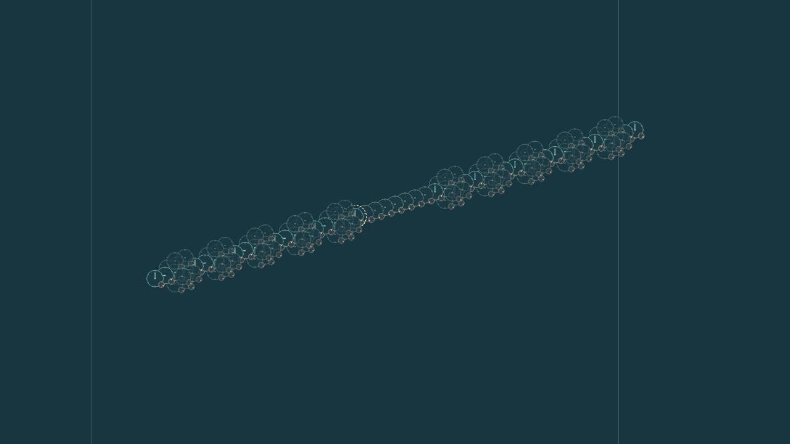

# Run and compose initial-state components

This detailed walkthrough preserves the four-placement demonstration and its
original evidence. For the current clock interfaces, use [the building-block
guide](CLOCK_SELECTION.md); for setup, use [Quickstart](QUICKSTART.md).


An initial-state component is an immutable pattern of triples, together with
named addresses, sockets and readouts. A recipe prepares that pattern before
the run. It does not install a private particle, detector or gate updater.

| Layer | Location | Responsibility |
| --- | --- | --- |
| Reference engine | `universe24/` | Fixed Rule3, topology, coupling and complete states |
| Component library | `research/components/` | Data-only recipes, placement and conflict checks |
| Experiments | `research/experiments/` | Choose preparations, run the engine, record complete states and inspect outcomes |
| Presenter | `research/presenter/` | Replay recorded states as clocks and gears |

Recipes include `SignalSource`, `GuideSegment`, `Receiver`, `PairedArm`,
`GuidedPacketSource` and the general `Patch`. Their behavioral claims apply
only to documented preparations, couplings, environments and time windows.

## Select four components for one connected run

This example selects **four instances from three recipes**: two initial
signal sources, one guide and one receiver. The receiver's same counters and
remainders carry its clock and memory readouts; there are no separate clock
and memory evolution rules.

From the repository root, run:

```bash
python -m research.experiments.run \
  --spec research/experiments/examples/four_component_demo.json \
  --output runs/my-four-component-demo
```

Open `runs/my-four-component-demo/The_Presenter.html` in a browser that runs
JavaScript. Select a source control, press **Play**, and drag the cube to
rotate it. **Look inside** exposes the node's 48 channels. The command
computes a new trajectory; **Play** replays saved states. Select components
before a run by editing a copied JSON spec or using the Python API below.
The Presenter is an experiment player, not a visual component editor.

Output directories must be new. Python 3.11 or newer is sufficient, with no
optional visualization dependencies. This command does not require evidence
materialization. The same runner accepts `guided_packet.json`,
`assembled_demo.json` and `selected_examples.json` in the examples directory.

Here is the complete initial assembly in Python:

```python
from research.components import (
    BoardSpec, TensorSpec, SignalSource, GuideSegment, Receiver,
    place, finalize,
)

tensor = TensorSpec.from_signs((1, 1, 1))
origin = (110, 110, 110)
prepared = finalize(BoardSpec(side=221, tensor=tensor), [
    place(GuideSegment(start=-20, stop=28, sockets=(-20, 0, 28),
                       tensor=tensor), at=origin, name="guide"),
    place(Receiver(tensor=tensor), at=origin, name="receiver"),
    place(SignalSource(tensor=tensor), at=(90, 110, 110), name="first"),
    place(SignalSource(tensor=tensor), at=(138, 110, 110), name="second"),
])

states = list(prepared.engine.evolve(prepared.initial, 48))
receiver_channels = prepared.ports["receiver.node"]  # all 48 local channels
```

The guide sockets leave the three local positions unassigned for the two
sources and receiver. A socket is an initial-data contract; it adds no
connection to the lattice. All four instances must share the exact same
global tensor and background. Different triples at a shared address are
rejected; identical triples retain all owners in the manifest. The finalizer
does not add counters, average states or accept a last writer. It also
rejects independent sources sharing an address, unfilled sockets and explicit
wrapping that aliases distinct local addresses.

## What the four source controls show

Both sources are initially prepared. Their later effects come from the
closed-board dynamics. An absent-source control zeroes only its initial
counters, retaining the same remainders, guide, receiver and tensor.
The fresh demonstration records all four controls through 48 updates:

| Initially present sources | Receiver C-bearing and remainder-change steps | Receiver magnitude after the final event |
| --- | --- | --- |
| Neither | None; the whole board is stationary | `I=0` |
| First only | 20 | `I=1` in each paired channel |
| Second only | 28 | `I=1` in each paired channel |
| Both | 20 and 30 | `I=4`, following the earlier `I=1` interval |

For both sources, the remainder pair changes
`(4,0) -> (0,4) -> (4,0)` at those two receiver times and stays fixed between
them. Each time contains two individual channel events, in channels 0 and
14: four arithmetic events in total. All 48 receiver channels are observed;
the other 46 remain quiet. This is not a two-photon or exclusive single-event
claim. The final remainder pair returns to its original value; the counter
magnitude `I=4` distinguishes the final state from the initial `I=0`.

The second event occurs at 30 jointly rather than 28 in isolation because
the actual incoming waveform changes through interaction. No external timer
inserts or delays an event. The counter pair rotates between arrivals, while
its magnitude and the stated remainder record remain stable over the tested
intervals. A normalized clock hand alone does not show `I`; inspect the exact
counters or the declared magnitude/phase readouts.

The [four-control recording](../research/experiments/evidence/publication_v1/four_component_demo/The_Presenter.html)
retains all 196 full states. The [independent review](../research/component_review/publication_demo_review.json)
checks their equality with the earlier controls and all 192 transitions with
separate matrix-based forward/inverse calculations.

Two views replay the same 49 states of the combined preparation:

| Whole periodic cube | Prepared apparatus closeup |
| --- | --- |
|  |  |
| [Rotate the complete cube](../research/experiments/evidence/publication_v1/whole_cube_render/sequence-01/recorded-clocks.gif) | [Watch the recorded clocks](../research/experiments/evidence/publication_v1/render/sequence-01/recorded-clocks.gif) |

The board is three dimensional; these four placements form a line along its
X axis. Uniform background clocks are omitted from this large-board drawing
and retained in the complete state. The [initial viewer](../research/experiments/evidence/publication_v1/initial_view_review.json)
already opens on the whole cube. **Reset view** restores that framing;
**Focus retained state** enlarges the prepared apparatus. Drag to rotate.
The [render verification](../research/experiments/evidence/publication_v1/whole_cube_verification.json)
checks identical recorded states and all eight cube corners inside every frame.

This is a finite composition result for this preparation, not indefinite
reuse, a guide-ablation result, physical light or unique-path confirmation.

## Run individual components on separate boards

Separate runs give each preparation its own complete board and environment.
They do not exchange signals. This command records three such experiments:

```bash
python -m research.experiments.run \
  --spec research/experiments/examples/standalone_components.json \
  --output runs/my-separate-components
```

The receiver alone and guide alone have zero counters and stay stationary,
as Rule3 requires. That is their resting behavior; it does not test a response
to an incoming signal. A standalone `SignalSource` is a prepared disturbance;
its name does not guarantee a mobile ray. The verified compact moving packet
requires `GuidedPacketSource`, its complete remainder halo and its declared
periodic guide together, as specified in `guided_packet.json`.

In Python, a receiver-only board is:

```python
receiver_only = finalize(BoardSpec(side=33), [
    place(Receiver(), at=(16, 16, 16), name="receiver"),
])
separate_states = list(receiver_only.engine.evolve(receiver_only.initial, 8))
```

A separate call to `finalize` with a guide creates a different board. Putting
compatible placements into one call creates one shared board. Their influence
can then travel only through the existing six spatial connections. Running
separately, running together and adding recorded trajectories afterward are
three different operations. The carry example in the [algebra and composition guide](ALGEBRA_AND_COMPOSITION.md) explains
why post-hoc addition does not reproduce a joint run.

## Historical publication evidence and limits

The counts below describe the earlier component publication, not the current
repository test total. Use [Quickstart validation](QUICKSTART.md#full-research-validation)
for the current dependency and evidence setup. The original receipts remain
unchanged.

All `universe24/` files remain unchanged. The original full suite passed
120 tests. The initial publication candidate passed [all 124 tests](../research/experiments/evidence/publication_v1/validation.json).
After bounded archive transport was added, the revised candidate passed
[all 127 tests](../research/experiments/evidence/publication_v1/parts_validation.json)
with zero failures, errors or skips in a fresh Git checkout containing only
the archive parts. Seven tests exercise evidence restoration and reject missing,
corrupt or reordered parts. The report pins the tested source tree. Separate
checks reproduced the four component controls and standalone examples.
Historical provenance tests need Git history: an initial file-only test copy
produced three Git-context errors, [preserved here](../research/experiments/evidence/publication_v1/initial_no_git_validation.json);
the same source passed in the documented Git environment. The [pinned delivery archive](../research/artifacts/Universe24_Components.parts/manifest.json)
retains 1,234 new study recordings, 51,638 complete states, frozen protocols
and source snapshots. Its exact 44,029,448 bytes are stored as 42 numbered
parts because the publication connector could not transfer one large blob.
The same command reassembles them in memory, verifies every part and the
unchanged full-archive checksum, and then restores the data. No extra setup
step or network access is required. Restore their original evidence paths and the 24
Presenter import parts with:

```bash
python -m research.experiments.materialize_evidence --check-only
python -m research.experiments.materialize_evidence
```

This offline checksum-locked materializer writes only declared research
evidence, including frozen historical source snapshots. It cannot replace
live engine, recipe, runner, test, documentation or configuration files. It
rejects path escapes and differing existing files. After restoration,
`research/experiments/evidence/assembly_v1/complete_collection/index.html`
lists every recording and import part. The generic example commands work
without this restoration step.

Software correctness and scientific acceptance remain separate. Guided packet
translation has a proof for its exact prepared periodic guide. Finite OR/NO
competition works in its stated cases. The larger cooperation-score prediction
failed all ten eligible comparisons; strict waiting accepted none of 145
preparations. A joined route activates its receiver at step 12 but the record
changes again at step 14, so one-click persistent confirmation is unestablished.
The [claim ledger](COMPONENT_RESULTS.md) preserves these limits.

The rendering logic was checked using DOM/native Canvas2D. Actual Safari/iPad
playback is unverified. An attachment preview may disable JavaScript; its
static experiment list cannot play or rotate. Download a recorded HTML file
and open it in a browser that executes its scripts.

