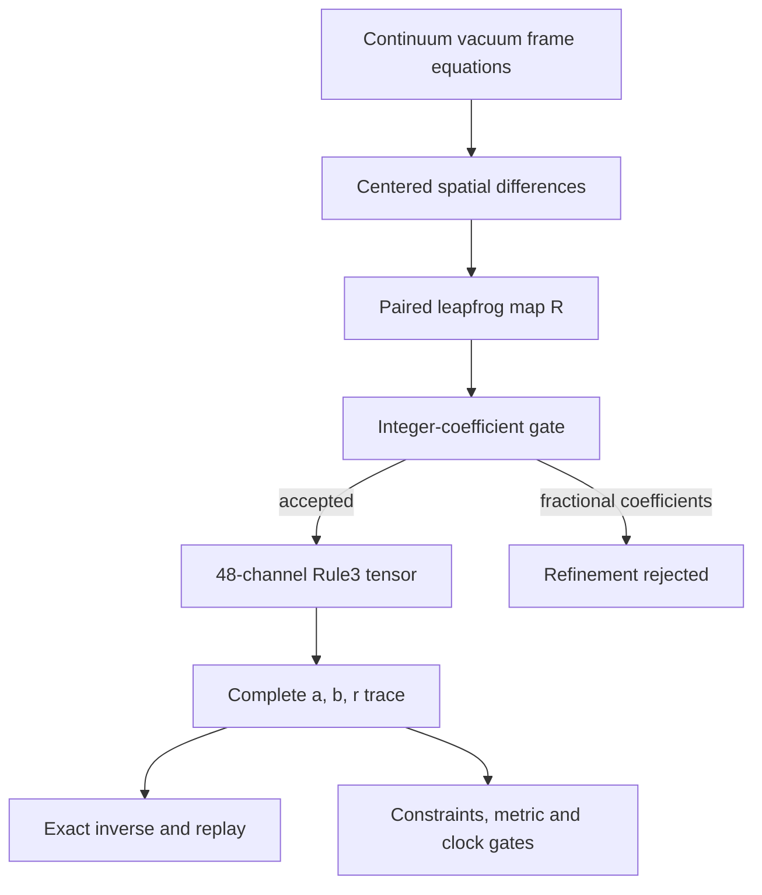

# Frame48: research synthesis and a bounded-channel implementation

> Historical research/reference document. The current supported interface and acceptance status are defined in [ONE_SYSTEM.md](ONE_SYSTEM.md). Commands and default-model descriptions below refer to the earlier construction; see [the 0.6 migration](MIGRATION_0_6.md). No general ≤48-channel physical model is accepted.


Status, 2026-11-11: **48-channel reversible candidate implemented; general GR
solver validation fails.** The new result is an exact, horizon-independent
embedding of a nonlinear frame leapfrog map. Constraint preservation,
nondegeneracy, fine integer resolution and an operational clock remain open.
The default ADM system is not changed. Passing tests of the negative controls
do not turn these failed physical gates into successes.

## Research map and source ledger

These are primary sources consulted for this investigation. Links identify
the actual works, not search summaries. The last column is our assessment of
fit to this repository, not a claim by the cited authors. This is a targeted
review, not an exhaustive literature survey or a claim of novelty.

| Source | Established contribution relevant here | Fit and limitation for Rule3 |
| --- | --- | --- |
| [Buchman & Bardeen, 2003; corrected arXiv v2, 2005](https://arxiv.org/abs/gr-qc/0301072v2), *A hyperbolic tetrad formulation of the Einstein equations for numerical relativity* | Frame-based vacuum evolution with explicit gauge choices and a hyperbolic formulation | Supports the frame-variable direction. Our synchronous reduction below is independently derived and checked; it does **not** inherit their hyperbolicity result or reproduce their constraint additions. |
| [Alekseenko & Arnold, 2003, arXiv v2](https://arxiv.org/abs/gr-qc/0210071v2), *A new first-order formulation for the Einstein equations* | 20 unknowns in the nonlinear formulation; 14 in its linearized subsystem, with metric recovered separately | Shows that thousands of physical variables are unnecessary. Its nonlinear inverse-metric dependencies are not automatically low-degree integer updates. Do not quote 14 as the count for full nonlinear GR. |
| [Wise, 2010, section 5.1](https://arxiv.org/abs/gr-qc/0611154v2), *MacDowell–Mansouri gravity and Cartan geometry* | Relates coframe, connection, Palatini equations and Einstein geometry | Basis for the earlier 16+24 component proposal. Polynomial residuals do not themselves define an explicit constraint-preserving Rule3 evolution. |
| [Gambini & Pullin, 2001](https://arxiv.org/abs/gr-qc/0108062), *Consistent discretizations for classical and quantum general relativity* | Constructs discretizations from a consistency requirement on the discrete equations | Useful alternative to naive equation substitution; does not supply this repository's fixed-six, single-edge 48-channel update. |
| [Gambini, Ponce & Pullin, 2005](https://arxiv.org/abs/gr-qc/0505043), *Consistent discretizations: the Gowdy spacetimes* | Nonlinear gravitational examples with local degrees of freedom, numerical convergence and approximate constraint preservation | A relevant benchmark and constraint methodology; the published result is not exact preservation by a generic small integer automaton. |
| [Bahr & Dittrich, 2009](https://arxiv.org/abs/0909.5688), *Breaking and restoring of diffeomorphism symmetry in discrete gravity* | Examines symmetry breaking by discretization and symmetry-restoring actions | Explains why continuum gauge/constraint identities cannot simply be assumed on a grid. It is not a no-go theorem for every integer encoding. |
| [Regge, 1961](https://doi.org/10.1007/BF02733251), *General relativity without coordinates* | Foundational coordinate-free discrete-geometric route; bibliographic record/abstract consulted | A separate discretization direction. No Regge evolution implementation or detailed equivalence to our cube stencil is claimed in this PR. |
| [Elze, 2014](https://arxiv.org/abs/1312.1615), *Action principle for cellular automata and the linearity of quantum mechanics* | Integer Hamiltonian cellular automata and a sampling-theory relation to linear quantum dynamics | Relevant to deterministic integer dynamics. It does not establish nonlinear Einstein gravity or our 48-channel construction. |
| ['t Hooft, 2016, arXiv v3](https://arxiv.org/abs/1405.1548v3), *The Cellular Automaton Interpretation of Quantum Mechanics* | Deterministic-model program and quantum-mechanical interpretation; abstract/overview consulted | Conceptual context, not an implemented general-relativity solver used here. No full-book technical verification is claimed. |

The examined sources do not establish the conjunction needed here: nonlinear
four-dimensional GR, the unchanged fixed-six recurrence, strict single-edge
support, fixed 48 integer channels, arbitrarily refinable resolution,
constraint preservation and an operational physical clock. The implementation
below separates these obligations rather than identifying determinism with GR.

## One picture: fields, discrete map, Engine, measurements



The heavy ADM compiler retains arithmetic work for every future step. This
candidate instead fixes a gauge, retains two physical field slices and
repeatedly applies the same map. Its channel count is constant; integer bit
length and exported trace size are not bounded. All 48 channels belong to
`frame48_experiment`; none are shared with the ADM/communication owners.

The initial 40 geometric components plus 8 spare channels was a budget idea,
not a demonstrated dynamics. The implemented allocation is different:

| Fields per slice | Count | Meaning |
| --- | ---: | --- |
| B_a^i | 9 | Spatial inverse triad: e_a=B_a^i partial_i |
| K_ab=K_ba | 6 | Extrinsic curvature in that orthonormal frame |
| Gamma_ab c=-Gamma_ba c | 9 | Spatial rotation coefficients |
| Total | 24 | One gauge-fixed vacuum slice |
| X and Y banks | 48 | Two consecutive slices; no spare clock or matter bank |

The count 48 is twice 24; it does not identify these fields with the existing
binary-octahedral reference channels.

This is synchronous slicing, alpha=1 and beta=0, with a Fermi-propagated
spatial frame. It represents a local gauge choice before normal-congruence
caustics, not a global gauge covering every spacetime. Symmetric K assumes
hypersurface orthogonality. Spatial dependence and off-diagonal fields are
allowed; no homogeneous or plane-wave ansatz is imposed on the equations.

## Continuum algebra and the exact boundary of the derivation

Let Gamma^a_bc=<nabla_(e_c)e_b,e_a>, D_a=B_a^i partial_i, and
C^a_bc=Gamma^a_cb-Gamma^a_bc. Then

    R^a_bcd = D_c Gamma^a_bd - D_d Gamma^a_bc
              + Gamma^a_ec Gamma^e_bd - Gamma^a_ed Gamma^e_bc
              - C^e_cd Gamma^a_be,
    Ric_ab = sum_c R^c_acb.

With the repository's K sign convention, the vacuum equations in this gauge
give

    dot B_a^i = K_ab B_b^i,
    dot K_ab = Ric_ab + tr(K) K_ab,
    dot Gamma_ab c = nabla_a K_bc - nabla_b K_ac
                     + Gamma_ab d K_dc.

For example, the two frame-transport contributions cancel the `-2K^2`
term in coordinate ADM's dot K. Covariant derivatives of K include both
connection terms. Each RHS is quadratic in the retained fields and their
first coordinate differences. No inverse triad is needed by this RHS.

These equations describe vacuum Einstein evolution **on the compatible,
constraint-satisfying continuum domain**. The additional conditions include

    H = tr(Ric) + tr(K)^2 - tr(K^2) = 0,
    M_a = sum_b nabla_b K_ab - nabla_a tr(K) = 0,
    [e_a,e_b]^i = C^c_ab B_c^i,
    det B != 0.

Ordinary centered differences replace partial_i. Off the compatible domain,
Ric need not be symmetric. The six K equations explicitly select its upper
triangle, and the observer reports the antisymmetric defect. This is a
declared off-constraint closure, not a hidden projection or the full WEBB
hyperbolic formulation. Its generic hyperbolicity/stability is unproved.

Independent tests use a rotated, inhomogeneous coordinate metric to verify
spatial Ricci and the B/Gamma evolution identities. A curved vacuum Kasner
solution checks the continuum RHS and is separately tested with the existing
four-dimensional metric-jet Einstein/Riemann oracle.

## Exact 48-channel Rule3 lift

Let f be the spatially discretized 24-field RHS and F=2h*f. Define

    R(x,y) = (y, x+F(y)),
    R^-1(x,y) = (y-F(x), x).

This is the centered time formula y_(n+1)=y_(n-1)+2h*f(y_n), with the two
time slices included in the target state. It is not Euler's noninvertible
single-slice update. No auxiliary reset is assumed.

For b=(x,y), prepare a=R^-1(b), and retain arbitrary valid r. Build

    u_X = 6 y - 3 F(x),
    u_Y = 6 x + 3 F(y).

If F has integer polynomial coefficients, u=3(R+R^-1)b. Consequently
`divmod(2u+r,6)=((R+R^-1)b,r)`, and the actual Engine step gives

    b_next=R(b),  a_next=b=R^-1(b_next),  r_next=r.

This proves an exact invariant encoding in both directions, including every
remainder. It does **not** prove preservation of the Einstein constraints.
The previous/current banks advance in the same physical direction; they are
not forward/backward copies of the doubled involution construction discussed
in PALATINI_TARGET.md. This direct R+R^-1 embedding avoids another doubling.

At h=dx=1 the built tensor has exactly 48 gears and 762 canonical monomials,
input degree two (tensor rank three), all b-only and strictly single-edge.
Products are on-site or join a base-node coefficient to one neighboring
field. Gamma is a node-sampled rotation coefficient, **not** a group-valued
physical link; exact lattice Lorentz gauge covariance is not claimed.

There is no scheduler, runtime injection, clock ring, step-dependent tensor,
future-state seed, or construction-time horizon. All fields remain integers
and Engine automatically uses arbitrary precision when required.

## Resolution and clock gates: what remains unsolved

The exact lift requires integer coefficients of F. At fixed dx=1, h=1/2 and
h=1/16 are explicitly rejected; there is no hidden rounding or new divisor.
The joint half-grid h=dx=1/2 does compile, but h=dx=1/4 fails because of
nonlinear coefficients. This is a specific integrality barrier, not a claim
that every smaller step or every possible 48-channel encoding is impossible.
Rescaling the fields is not a free cure: for a quadratic RHS, encoding y=b/S
produces an increment proportional to h/S times a quadratic in b. The same
divisibility problem returns. A fixed channel count also says nothing about
the number of bits needed by an integer.

A separate floating homogeneous Kasner reference uses h=1/16,1/32,1/64 and
shows decreasing errors. Those trajectories **do not compile into this
integer sector**. They test the continuum equation mapping and time stencil,
not a refinement theorem for the implemented Engine run. The two-step method
also has a computational/parasitic mode; slice constraints alone do not
specify a physically consistent initial time pair.

The observer supplies the polynomial contravariant metric
`g^mu nu=diag(-1,B^T B)`. A singular B causes explicit rejection. The continuum
covariant metric would be `g=diag(-1,(B^T B)^-1)`; this candidate does not
expose that generic dynamic ratio as an authorized physical readout. Exact
coordinate-metric inversion is used only by the independent test oracle.
For normal observers, coordinate t equals proper time by the chosen gauge.
There is no retained oscillating apparatus, gravitational-redshift test or
general clock agreement. The physical-clock gate is therefore false. Calling
each Engine step a clock tick would not resolve it.

### Relationship to the merged compact FLRW work

During this investigation PR #35 was merged. This branch was rebased onto it;
the models remain separate, with the following comparison:

| Construction | Retained channels per node | Established scope | Clock status |
| --- | ---: | --- | --- |
| [Compact null wave](COMPACT_NULL_WAVE.md) | 2 | Prepared transported vacuum-wave coframe | No physical clock apparatus |
| [Compact FLRW, PR #35](COMPACT_FLRW_CLOCKS.md) | 8 | Homogeneous isotropic flat dust/radiation family; exact subdivision identities | Retained proper-time and null affine counters in that prepared family |
| Frame48 | 48 | Exact reversible nonlinear vacuum-frame candidate | No retained clock; generic physical gates false |
| [Default ADM](INTEGER_ADM.md) | 4,771 Einstein channels at the documented one-step setting | General spatially varying discretized scalar/dust Einstein model; finite horizon | Passive rates from its own ADM metric, including normal and grid observers |

FLRW's subdivision parameter is supported by a specific polynomial invariant
and fixed calibration denominators. It is not an authorization to insert a
denominator into Frame48's generic RHS. Its proper-time counter does not
automatically measure the frame candidate's geometry. Likewise, evaluating
the default ADM metric's clock rate is distinct from a ticking apparatus.
These distinctions follow the current AGENTS.md contract and prevent a
successful restricted sector from being mislabeled as a general solution.

## Reproduction, evidence and collaborator handoff

```bash
python experiments/geometry/frame48_audit.py --out runs/frame48
python -m unittest universe24.tests.test_frame48 -v
```

[The source-hashed evidence](evidence/frame48_research.json) includes the
manifest, tensor fingerprint, complete-trace hashes and all failed gates.
The runner exports every `(a,b,r)` snapshot, including frozen nonzero r.
Tests replay the exported trace with the saved tensor.

| Evidence case | What it establishes |
| --- | --- |
| Flat, 120 updates | Exact stationary vacuum control with unchanged allocation and complete rewind |
| Nonlinear anisotropic, 6 updates | Actual nonlinear map and rewind; initial X=Y is not an analytic Kasner time pair and is not advertised as a physical solution |
| Spatial off-constraint data, 3 updates | Neighbor coupling, exact lift and rewind for generic integer data; no Einstein claim |
| Two individually constrained slices | H changes from zero on each slice to 4 after one step; temporal consistency and constraint propagation remain unresolved |
| Initially invertible frames | A declared pair becomes singular after one step; nondegeneracy is not automatic |
| Small timestep requests | Unsupported noninteger coefficients are rejected explicitly |

The next changes should address the failed gates, not add positive labels:

1. Derive a compatible reversible time-pair initialization and a constraint
   propagation/stability result; audit spatially varying vacuum data.
2. Supply an explicit refinable integer encoding within a measured budget,
   including every scratch register/remainder. If 48 is insufficient, report
   the actual lower-level allocation instead of hiding it.
3. Prove a nondegenerate domain of the chosen map, with a declared policy at
   coordinate-caustic boundaries. Do not project states after Engine updates.
4. Add an independently ticking clock coupled to this same geometry, then
   test moving clocks and nontrivial gauge/lapse cases. Matter requires its
   own equations and budget; this vacuum candidate does not replace ADM's
   complex scalar or dust.

Implementation paths: `algebra/frame_equations.py` owns the equation mapping;
`layers/frame48.py` constructs the fixed tensor and rejects unsupported
coefficients; `prepare/frame48.py` encodes the complete pair;
`observe/frame48.py` only measures. No default command or historical result
has been redirected to this candidate.
