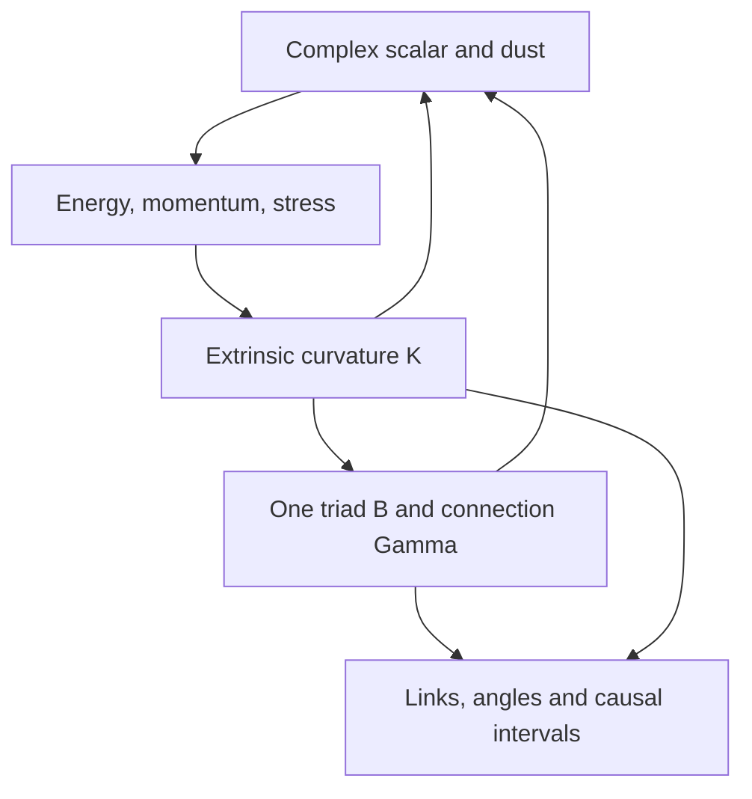

# One geometry with energy, momentum and matter: Frame70

Status, 2026-11-11: **one mutually coupled 70-channel experimental tensor is
implemented; a general convergent Einstein solver is not established.** It
uses the same complex scalar and normal-comoving dust content as the default
ADM model, with a different frame/time discretization and a signed square
encoding for dust. It does not run a second metric alongside the default.
The default ADM remains the operational finite-horizon implementation.

This extends [Frame48](FRAME48_RESEARCH.md), on main after PRs #36 and #37.
All successful identities and failed physical gates below are part of the
handoff. The source-hashed [evidence](evidence/frame_matter.json) records the
actual integer runs, not just continuum calculations.

## Sources and what was checked

| Primary source | Use in this investigation | Boundary |
| --- | --- | --- |
| [Gourgoulhon, *3+1 Formalism and Bases of Numerical Relativity* (2007)](https://arxiv.org/abs/gr-qc/0703035), [author PDF](https://luth2.obspm.fr/~luthier/gourgoulhon/pdf/form3p1.pdf), sections 4.1–4.5, 5.2–5.3 and 10.3 | Matter projections, sourced ADM evolution, energy balance, dust and continuum constraint propagation | Does not prove constraint propagation for our integer leapfrog; numerical gauge choice and stability remain separate obligations. |
| [GRChombo scalar-field implementation](https://grtlcollaboration.github.io/Doxygen/html/_scalar_field_8impl_8hpp_source.html), rendered source at commit `2cc2525e20260c136a344c54c6c68db5ab76652e`, lines 42–66 and 92–124 | Independent reference for the sign of Pi, scalar stress, potential force and Klein–Gordon evolution | It uses a different numerical formulation; no GRChombo stability result or code equivalence is claimed. |
| [Prior nine-source frame/discrete-gravity ledger](FRAME48_RESEARCH.md#research-map-and-source-ledger) | Context for frames, deterministic integer dynamics and constraint-preserving discretization | The new coupled map and its square-density encoding are derived and tested here. No novelty or exhaustive literature claim. |

## One coupled system, not a separate gravity for each channel



The diagram describes continuum meaning. The integer implementation evaluates
all channels from the same complete old snapshot. There is no callback,
post-step projection, source injection or separately evolving matter metric.
The channel assembly has one owner, `coupled_frame_matter`, and one candidate
metric authority, its B field. Communication/Bell audit clicks are not added
to its stress tensor and are not relabeled as particles.

| Retained fields in each time slice | Count | Role |
| --- | ---: | --- |
| Inverse triad B_a^i | 9 | e_a = B_a^i partial_i |
| Symmetric K_ab | 6 | Normal change of spatial geometry |
| Antisymmetric Gamma_ab c | 9 | Spatial frame connection |
| phi, Pi, Q_a | 5 | First real component and its time/spatial derivatives |
| chi, Pi_chi, W_a | 5 | Second real component and its derivatives |
| Signed dust amplitude d | 1 | rho_d = d^2, normal-comoving pressureless dust |
| One slice | 35 | Geometry and all retained matter |
| Previous/current X,Y banks | 70 | Fixed allocation, no spare clock apparatus |

A real-scalar-only first-order allocation would use 58 channels. The actual
implementation retains both scalar components and dust, hence 70. This is
an honest allocation, not a lower-bound theorem or a claim that 48 can never
work. Tensor monomials and symbolic compiler temporaries are not additional
runtime registers. Integer bit lengths and exported history still grow.

## Energy and momentum are different projections of the same tensor

We use signature (-+++), c=8 pi G=1, Lambda=0, lapse=1, shift=0, and the
Fermi-propagated frame of Frame48. This is a local synchronous gauge before
normal-congruence caustics, not a global chart for arbitrary spacetimes.
Let D_a=B_a^i partial_i and K=tr(K_ab). Define

\[
\Pi=\partial_t\phi,\quad Q_a=D_a\phi,\qquad
\Pi_\chi=\partial_t\chi,\quad W_a=D_a\chi,\qquad
V=\tfrac12m^2(\phi^2+\chi^2).
\]

These covectors turn field differences in a direction into scalar changes;
their contraction uses this same geometry. They are not an extra metric.
The four-dimensional matter tensor is

\[
T_{\mu\nu}=\partial_\mu\phi\partial_\nu\phi
 +\partial_\mu\chi\partial_\nu\chi
 -g_{\mu\nu}\left[\tfrac12(\partial\phi)^2
                         +\tfrac12(\partial\chi)^2+V\right]
 +d^2n_\mu n_\nu.
\]

Its orthonormal projections are

\[
\begin{aligned}
\rho &=\tfrac12(\Pi^2+\Pi_\chi^2+Q^2+W^2)+V+d^2,\\
j_a &=-\Pi Q_a-\Pi_\chi W_a,\\
S_{ab}&=Q_aQ_b+W_aW_b+
 \delta_{ab}\left[\tfrac12(\Pi^2+\Pi_\chi^2-Q^2-W^2)-V\right].
\end{aligned}
\]

Energy density sources the scalar constraint; momentum sources the vector
constraint; anisotropic stress changes different directions differently.
Replacing all three by a single scalar mass density would lose this content.
Einstein's equation fixes the Ricci part of curvature from T, not all Weyl
curvature: free gravitational data and waves still matter. A unique evolution
also needs compatible initial data and boundary conditions. This candidate
uses the repository's periodic cubic lattice, not an isolated-source boundary.

## The push and kick algebra

The gravitational update, using the curvature conventions of Frame48, is

\[
\begin{aligned}
\dot B_a{}^i &=K_{ab}B_b{}^i,\\
\dot K_{ab}&={}^{(3)}R_{ab}+K K_{ab}
 -\left[S_{ab}-\tfrac12\delta_{ab}(S-\rho)\right]\\
 &={}^{(3)}R_{ab}+K K_{ab}-Q_aQ_b-W_aW_b
                  -\left(V+\tfrac12d^2\right)\delta_{ab},\\
\dot\Gamma_{ab c}&=\nabla_a K_{bc}-\nabla_b K_{ac}
                          +\Gamma_{ab d}K_{dc}.
\end{aligned}
\]

Pi does not appear explicitly in the simplified K source: its kinetic
contribution cancels in this particular trace reversal. It still contributes
to rho, j, the constraints and geometric focusing. Omitting it from those
would be wrong. The equations for both real scalar components are

\[
\begin{aligned}
\dot\phi&=\Pi,&\dot\Pi&=K\Pi+\nabla^aQ_a-m^2\phi,
 &\dot Q_a&=D_a\Pi+K_{ab}Q_b,\\
\dot\chi&=\Pi_\chi,&\dot\Pi_\chi&=K\Pi_\chi+\nabla^aW_a-m^2\chi,
 &\dot W_a&=D_a\Pi_\chi+K_{ab}W_b,\\
\dot d&=\tfrac12 Kd.&&&&
\end{aligned}
\]

Here `div Q = sum_a D_a Q_a - sum_ab Gamma^b_aa Q_b`.
The gradient term transports matter, the potential supplies the scalar
restoring force, and K supplies expansion/contraction feedback. Meanwhile
matter stresses change K, which changes B. This closes both directions of
backreaction in one polynomial law. It includes normal-comoving dust, not a
general tilted fluid, shocks, electromagnetism or arbitrary matter potentials.

The constraints remain essential:

\[
\mathcal H={}^{(3)}R+K^2-K_{ab}K_{ab}-2\rho=0,\qquad
\mathcal M_a=\nabla_bK_{ab}-D_aK-j_a=0,
\]

along with triad/connection compatibility, Q=D phi and W=D chi. As in
Frame48, the off-constraint upper-triangle Ricci closure is explicit, and
the antisymmetric Ricci defect is measured. No hyperbolicity theorem for a
different constraint-added formulation is inherited.

"Push/kick" is a description of these roles, not a claim that our map is a
symplectic kick-drift-kick integrator. The canonical scalar momentum would
be p=sqrt(det gamma)*Pi; Pi itself is not that densitized canonical variable.
A canonical splitting would need its own retained representation and proof.

### A resolved failure: negative dust density

A direct leapfrog of rho_d can turn rho_d=1 into -1 when K=-1 and h=1,
even if both initial slices have positive density. We rejected that encoding.
Instead d is retained and rho_d=d^2 is a polynomial readout. The continuum
identity 2d dot(d)=K d^2 gives the correct normal-dust continuity equation.
Every integer snapshot has nonnegative dust density, including when d changes
sign. That sign is retained for reversal; there is no absolute-value update,
square-root evaluation or clipping. Scalar energy is also nonnegative for
the supported m^2>=0.

This does not prove discrete mass conservation. It restricts directly
representable dust densities to integer squares in the declared units;
arbitrary densities would need a justified calibration/encoding. Signed d
is an encoding variable, not negative physical matter. Dust caustics and
the remaining Einstein constraints are not resolved by positivity.

## From K to link length, angle, curvature and event time

The following are continuum geometric identities, checked by an independent
test oracle. They are **not** a newly authorized generic dynamic-ratio
readout in the integer Engine. The contravariant spatial metric is the
polynomial gamma^{-1}=B^T B; the covariant metric requires its inverse.
The default ADM already has a proved finite-horizon rational readout and
uses that one metric for its link/angle/clock reports.

For a fixed infinitesimal coordinate separation v, its frame components are
ell=B^{-T}v, with length L=sqrt(ell dot ell), and unit direction s=ell/L.
For another direction u, write its unit frame direction as q. Then

\[
\gamma=(B^TB)^{-1},\quad
\dot\ell=-K\ell,\quad
\frac{\dot L}{L}=-s^aK_{ab}s^b,
\]

\[
\cos\theta=s\cdot q,\qquad
\partial_t\cos\theta=-2s^aK_{ab}q^b
 +\cos\theta\,(s^aK_{ab}s^b+q^aK_{ab}q^b).
\]

Thus the trace of K controls volume expansion and its directional/shear
content controls relative lengths and angles. Connection Gamma describes
frame transport. Curvature describes the leading holonomy around a small
loop, with components proportional to R^a_bcd ell^c eta^d; a single link's
rotation or angle is not itself a curvature measurement. Finite links need
integration/quadrature and error control, not just a pointwise identity.

In this Fermi/synchronous convention the tidal tensor is

\[
E_{ab}=R_{a0b0}=\dot K_{ab}-(K^2)_{ab},\qquad
\ddot\ell^a=-E^a{}_b\ell^b.
\]

This is the local separation acceleration for nearby normal geodesics.
On the Hamiltonian constraint surface,
tr(E)=(rho+S)/2. Off it, the difference is exactly H with our normalization;
the test checks that relation. Scalar potential, kinetic energy, pressure,
gradients and dust therefore enter through the full sourced equations, not
through an arbitrary "mass-to-link-angle" force.

For a tangent (1,v), d tau^2/dt^2=1-gamma_ij v^i v^j. Normal observers
have v=0 and tau=t by gauge choice. There is still no ticking apparatus or
worldline integration in Frame70. A lattice event (node,tick) and a face-edge
computational dependency are not automatically an Einstein causal interval.
That identification requires a valid metric, constraints and convergence.

## One discrete step, frequencies and refinement

Let z contain the 35 fields, f their quadratic RHS with centered spatial
differences, and F(z)=2h f(z). The paired map is

\[
R(x,y)=(y,x+F(y)),\qquad R^{-1}(x,y)=(y-F(x),x).
\]

Initialize b=(x,y), a=R^{-1}(b), with every r in {0,...,5}. Compile

\[
u_X=6y-3F(x),\qquad u_Y=6x+3F(y).
\]

The unchanged fixed-six Rule3 advances exactly b'=R(b), a'=b, r'=r.
The two banks are time slices, not two geometries. All 70 channels advance
on this same update; there is no special "Einstein frequency" channel.
The default h=dx=m^2=1 yields **1,056 degree-two monomials**, strict single-edge
support and no runtime solver. The count is independent of run horizon.

Physical frequencies come from the equations, geometry and initial data.
Even the frozen flat-background scalar control has lattice dispersion
omega_k^2=m^2+sum_i(sin(k_i dx)/dx)^2. The paired first-order leapfrog has
unit-modulus modes only for |h omega_k|<=1 (the equality boundary can be
defective). Default h=dx=m=1 violates this bound for some spatial modes.
This is a stability warning for the continuum interpretation, not failure
of exact integer reversal. Dynamic geometry requires a substantially
stronger stability analysis; locality alone does not prove a metric light cone.

The compiler rejects noninteger F coefficients. Joint h=dx=1/2 now fails,
including for m=0 because of the retained dust terms. Spatial dx=1/2 with
h=1 compiles, but makes the timestep/resolution stability problem worse.
One cannot declare convergence merely by shrinking grid links. The floating
scalar-Kasner reference at h=1/16,1/32,1/64 has decreasing error; those runs
are explicitly separate from the integer sector and do not prove spatial
or general-GR convergence.

## What is verified, what still fails, and the integration decision

Continuum covariant conservation gives

\[
\dot\rho+\nabla_a j^a=K\rho+K_{ab}S_{ab},\qquad
\dot q+\nabla_a J^a=Kq,
\]

where q=phi Pi_chi-chi Pi and J_a=chi Q_a-phi W_a. The first equation is
local energy balance including geometric work; GR does not supply a generic
globally conserved scalar matter energy on every evolving spacetime.
Centered differences do not obey an exact pointwise product rule. The
observer differences the actual composite flux to measure that defect,
rather than substituting the continuum identity and reporting zero.

| Check | Result and limit |
| --- | --- |
| Four-tensor stress/source projections | Exact symbolic agreement, with both scalar components, momentum, potential and dust |
| Nonvacuum scalar-Kasner and dust FLRW | Independent full 4D Einstein tensor equals T; continuum RHS and constraints agree |
| Rotated inhomogeneous frame | Scalar RHS agrees with the coordinate wave operator; not an Einstein solution manufactured from the same RHS |
| Existing default ADM | Same homogeneous matter sources and frame-transformed K equation, checked exactly; no claim of identical spatial discretizations |
| Length, angle, proper-rate derivative and tidal trace | Independent continuum geometric checks; no new ratio readout/clock claim |
| Bidirectional coupling, vacuum reduction and replay | Exact integer checks, arbitrary valid remainders, big integers and complete saved-state replay |
| Dust positivity | Proved by square encoding, including signed-amplitude crossings |
| Hamiltonian constraint | Two individually constrained positive-energy slices yield an absolute H defect of 34 after a step; they are not a temporally consistent analytic solution pair |
| Scalar gradient constraint | Initially Q=D phi can drift after a step; no repair is inserted |
| Local energy and charge balance | Pointwise difference/product-rule defects occur; exact conservation is not claimed |
| Metric domain, clocks and full convergence | Still open, including inherited possible frame degeneracy and time-pair parasitic modes |

The resulting system is algebraically coupled, but this is not sufficient to
replace the existing ADM solver. A single default metric authority is
preserved. The safe integration direction is to use ADM's established
finite-horizon encoding as the full-system reference and admit the compact
representation only when it satisfies the same physical gates.

The next concrete work is (1) a compatible two-slice constrained initializer,
(2) a discrete gradient/flux and constraint propagation construction, (3) a
refinable integer encoding plus stability bounds, and (4) a shared-metric
operational clock and nondegenerate-domain test. Adding registers may be
necessary; any actual budget must include them. Fixed-degree first-order
matter needs retained gradients because eliminating them introduces higher
degree and multiple-neighbor products in the sources.

## Reproduce and continue

```bash
python experiments/geometry/frame_matter_audit.py --out runs/frame-matter
python -m unittest universe24.tests.test_frame_matter universe24.tests.test_frame48 -v
```

The audit saves the one tensor, ownership manifest and every (a,b,r) snapshot
for vacuum, combined matter, spatial coupling, constrained slices,
signed-dust and gradient-failure cases. All clicks remain labeled `audit`;
they are not claimed to be physical detections. The report pins source
hashes and the starting main commit so others can reproduce or falsify it.

`algebra/frame_matter.py` owns the coupled equations and stress projections;
`layers/frame_matter.py` compiles the fixed tensor;
`prepare/frame_matter.py` prepares the complete pair;
`observe/frame_matter.py` only measures defects. The default CLI and its
single ADM event-board metric are unchanged.
