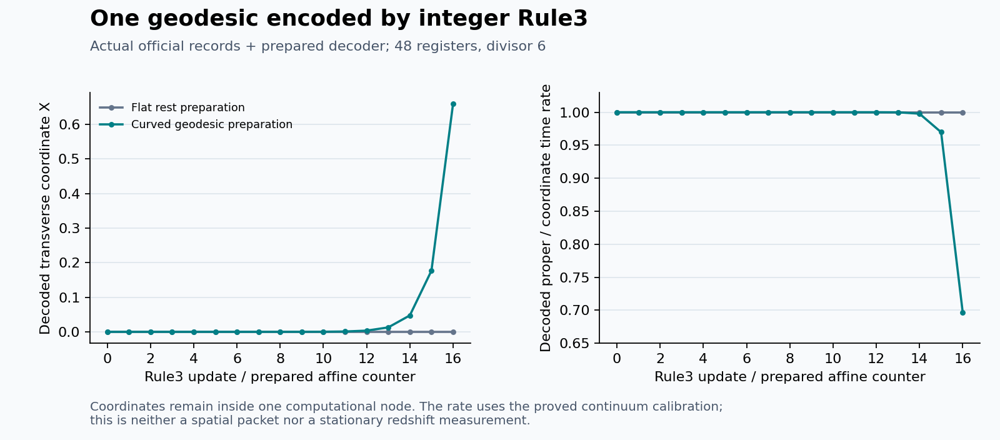

# A local integer geodesic readout in a prepared pp-wave sector

This construction extends the [local Palatini example](PPWAVE_PALATINI_LOCAL.md)
with four integer registers whose actual Rule3 history encodes one restricted
family of geodesics. Their inputs read the retained connection at the carrier
node and one face neighbor. The same fixed tensor therefore gives different
histories in the flat and curved preparations.

The result is a phase-space encoding of a worldline. Its coordinate registers
stay at one computational node; they are not a signal packet moving between
board nodes. The metric is a chosen exact vacuum family, the probe has no
backreaction, and a clock interpretation requires the declared preparation
and calibration. This does not supply a universal operational spacetime.

Run the isolated construction from the repository root:

```sh
python experiments/geometry/ppwave_geodesic_clock.py
```

The [runner](../experiments/geometry/ppwave_geodesic_clock.py) leaves the core
engine and default tensor unchanged. Its report records the full tensor
fingerprint, state hashes, actual official rows, decoded integer coordinates,
and both passing and failing controls.

The checked record is [ppwave_geodesic_clock.json](evidence/ppwave_geodesic_clock.json).
With the optional SymPy validation dependency, reproduce the independent
metric-to-Christoffel and exact-sample audit using
`python experiments/geometry/ppwave_geodesic_audit.py`.

## Metric and the local geometric input

Keep the 44 geometric bank registers from the preceding experiment. Use the
stationary preparations `P=2`, `A=c`, `B=0`, where `c` is either zero or one.
Here `c` labels the initial geometry; no additional selector gear is needed.
In a transverse coordinate chart,

    F = c(x^2-y^2),
    E = 2 I + F L,
    W_01 = 2 c x,       W_23 = -2 c y.

The remaining coframe and connection coefficients follow the definitions in
the preceding note. Stationarity makes the prepared geometric banks constant
under their Rule3 transport. At a carrier whose positive-x neighbor lies
inside the chart, the retained connection gives

    C = W_01(x+1)-W_01(x) = 2 c.

Both terms are ordinary old-snapshot reads. The difference is expanded into
separate tensor monomials; it is not a derivative callback during evolution.
Only the carrier has a nonzero probe preparation. Other probe registers remain
zero, including those at the periodic seams.

With light-front coordinates `U=T-Z`, `V=(T+Z)/2`, normalize the metric by its
constant scale, `h=g/P^2`. The analytic metric represented by the chart is

    h = -2 dU dV + dX^2 + dY^2 + c(X^2-Y^2) dU^2.

Its transverse profile is harmonic, so it is an exact vacuum plane wave for
`c=1` and flat for `c=0`. The lattice samples still have the transverse seam
failures documented in the preceding experiment. Nothing here repairs that
boundary problem. The probe's internal coordinates refer to the analytic
chart extending those samples; no general interpolation rule or moving-node
assignment has been derived.

## Four additional registers and the fixed tensor

Call the four registers `q`, `p`, `w`, and `n`. Every register retains its usual
complete triple `(a,b,r)`. Written in terms of their current `b` values, their
inputs are

    u_q = 6 q + 3 C q,
    u_p = 6 p + 3 C p,
    u_w = 6 q p + 18 C q p,
    u_n = 6 n.

These are fixed integer polynomials of input degree at most three. In
particular, the `C q p` term supplies tensor rank four. After expanding `C`,
each monomial uses the target and at most its positive-x face neighbor. No
old-`a` reads, runtime switch, fractional coefficient, or post-update overwrite
is used. The engine remains

    ell, r_next = divmod(2 u + r, 6),
    a_next = b,
    b_next = ell - a.

There are 48 registers in total: 44 geometric registers and four worldline
registers. These roles are not a binary-octahedral representation. The probe
reads the geometry without feeding back into it, so this is a test-probe
construction; it must not be described as a reciprocal matter-gravity system.

At the carrier, prepare

    b_q=1,       b_p=0,       b_w=0,          b_n=0,
    a_q=1+c,     a_p=-c,      a_w=-c(1+c),    a_n=-1.

All other probe values are zero. All remainders are zero except the carrier's
`r_n=epsilon`, with `epsilon` equal to zero or one. Every listed input is a
multiple of three. Thus all remainders remain exactly fixed, and the choice
of `epsilon` does not affect the quotient or counter evolution. This ledger
will label the mathematical null/timelike interpretation below; it is not an
observable mass inferred from the click stream.

## Exact prepared-sector proof

For the constant prepared geometric value `c`, define

    M_c = [[1+c, 3c], [c, 1+c]].

Since `c^2=c`,

    det M_c=1,
    M_c^-1 = [[1+c,-3c],[-c,1+c]],
    M_c + M_c^-1 = 2(1+c) I.

The prepared old history is `a_(q,p)=M_c^-1 b_(q,p)`. The Rule3 quotient is
`2(1+c)b_(q,p)`, so subtracting the old history gives exactly

    (q,p)_next = M_c (q,p).

The relation defining the old history is preserved. The product register has

    (q p)_next + (q p)_previous = 2(1+6c) q p.

This is precisely the Rule3 quotient for `w`. Therefore the complete prepared
trajectory obeys

    w_n = q_n p_n,       n_next=n+1.

For the curved preparation, the matrix also preserves

    q_n^2 - 3 p_n^2 = 1.

Let `alpha=arcosh(2)`, so `sinh(alpha)=sqrt(3)`. Exact closed forms are

    c=1: q_n=cosh(n alpha),    p_n=sinh(n alpha)/sqrt(3),
    c=0: q_n=1,               p_n=0.

The formulas describe the integer recurrence; no transcendental function is
called by the engine. The flat preparation is a transverse rest trajectory,
not a solver for arbitrary flat initial velocities. The restrictions
`c in {0,1}` and the prepared old histories are essential. The same tensor on
other states is not covered by this geodesic proof.

Every full engine step remains invertible by the unchanged generic inverse.
The stronger worldline interpretation above is only a prepared-sector result;
engine reversibility by itself does not establish it.

## Exact worldline and clock interpretation

Choose one fixed positive integer length calibration `D_length`. It is
unrelated to the engine divisor six. The same calibration is used for all
backgrounds. At an observation sample define

    U = alpha n,
    X = q / D_length,       Y = 0,
    V = (sqrt(3) w / D_length^2 + epsilon alpha n) / 2,
    T = V + U/2,            Z = V - U/2.

These are passive physical-coordinate formulas. In particular, `alpha`,
`sqrt(3)`, and the fixed scale denominators never enter a tensor coefficient,
a seed arithmetic operation, or an engine update. A numerical display of the
coordinates is an approximation to this exact symbolic readout, not a
floating-point fundamental state.

Interpolate the proved trajectory using `U` as affine parameter. In the
curved case,

    X' = sqrt(3) p / D_length,
    X'' = X,
    V' = (epsilon + (q^2+3p^2)/D_length^2) / 2.

In the flat rest case, `X'=X''=0` and `V'=epsilon/2`. Both satisfy the
geodesic equations of the declared metric and the exact normalization

    h(dx/dU, dx/dU) = -epsilon.

This assertion includes the geodesic equations, not only a normalization
chosen by the decoder. Computing the Christoffel symbols directly from `h`
gives the nonzero components

    Gamma^X_UU = -c X,        Gamma^Y_UU = c Y,
    Gamma^V_UX = Gamma^V_XU = -c X,
    Gamma^V_UY = Gamma^V_YU = c Y.

At `U'=1`, `Y=Y'=0`, all four coordinate equations reduce to
`U''=0`, `X''=c X`, `Y''=0`, and `V''=2c X X'`. The exact interpolants above
satisfy each equation. Independent symbolic differentiation of the full
metric confirms these residuals and the norm for symbolic `epsilon`.

For `epsilon=1`, normalized proper time is `tau=U=alpha n`. Proper time for
the unnormalized metric `g=P^2 h` is `P alpha n`. For `epsilon=0`, `U` is an
affine parameter and proper time is zero; the `n` register is not then a
physical ticking proper clock.

For the timelike interpretation the instantaneous coordinate-clock relation
is the exact rational expression

    d tau / d T = 2 D_length^2 /
        [2 D_length^2 + c(q^2+3p^2)].

The flat rest trajectory has ratio one; the curved trajectory has a changing
ratio below one. This is a coordinate/proper-time relation along the encoded
free-fall trajectory. It includes the trajectory's motion and must not be
reported as an isolated static gravitational redshift measurement. There is
no second independently constructed clock apparatus measuring `T`.

The default finite comparison uses `D_length=2^30` for 16 updates. At its last
curved sample,

    q=708158977,        p=408855776,
    w=289534888072701152,
    q < D_length.

Thus `|X|<1` throughout that finite interval. Along `Y=0`, fixed-coordinate
`T` lines are timelike because `h_TT=-1+c X^2<0`, and the `T` slices are
spacelike. This calibration establishes the chart condition for this finite
comparison; it is not an emergent length scale or an all-time bound.



The plotted points come from the official-record decoder. The rate uses the
proved coordinate formula above, not a separate detector measurement. With
Matplotlib installed, reproduce the display using
`python experiments/geometry/plot_geodesic_clock.py`. Floating arithmetic is
confined to this passive display; the engine and exact evidence use integers.

An independent audit compared all 51 decoded samples in the three default
cases against exact powers of `2+sqrt(3)` and `2-sqrt(3)`, as well as checking
all four continuum geodesic equations. It did not use the tensor recurrence
as its trajectory oracle.

Plane-wave geodesics reduce to transverse oscillator equations, with the
longitudinal coordinate fixed by normalization. See Matthias Blau,
[*Plane Waves and Penrose Limits*](https://blau.itp.unibe.ch/lecturesPP.pdf),
section 2.3; and Abraham I. Harte,
[*Tails of plane wave spacetimes: Wave-wave scattering in general relativity*](https://arxiv.org/pdf/1309.5020),
section II. The signs and normalization here follow directly from the metric
written above.

## What can actually be reconstructed from official clicks

An official record retains a nonzero quotient `ell` only when the triple
changes. Consequently, a missing record does not generally mean `ell=0`.
The flat `q` register is a concrete counterexample: its triple stays at
`a=b=1`, its quotient is two, and it produces no official row.

For the particular prepared `p`, `w`, and `n` trajectories, every missing row
does have zero quotient. Given their initial two histories, the decoder can
therefore use official rows only:

    ell_k = recorded quotient, or zero if absent,
    b_(k+1) = ell_k - a_k,
    a_(k+1) = b_k.

No current board snapshot is needed by that decoder. Then recover the
remaining coordinate from the proved prepared-sector identity:

    q = w/p when p != 0, with exact divisibility required;
    q = q_initial=1 when p=w=0.

Curved `q` click rows provide a separate consistency check. This is not a
universal inverse of the official readout: it uses the declared positive
prepared orbit, the initial histories, and `w=qp`. A decoder that fills all
missing `q` rows with zero would fail on the flat control.

The complete list of observation slots must retain updates with no records.
The sample index is bookkeeping for the encoded trajectory; the experiment
does not derive an observer-independent global time from click ordering.

The null and timelike curved preparations differ only in `r_n=epsilon`.
Their official records are identical, although the chosen worldline
interpretations differ. Thus official clicks alone do not identify the norm
sector. The decoder needs the initial remainder calibration. Assigning
`epsilon=0` is a mathematical null-trajectory control, not evidence that a
photon or an independently propagating light signal has emerged.

Two further controls distinguish actual response from a renamed seed. With
identical complete initial probe triples, changing only the geometry gives
the first next-position values two and zero. This control demonstrates
geometry-dependent input, although the flat member with that history is
outside the geodesic preparation. Setting `c=2` instead gives a product defect
`w-qp=-48` after two steps while still rewinding exactly. Thus the binary
geometry restriction cannot be removed without a different proof or model.

## Why an exact two-axis linear extension is not automatic

A narrower mathematical obstruction applies to a tempting extension. Consider
the full transverse linear geodesic system for a stationary vacuum wave with
profile `kappa(X^2-Y^2)`, where `kappa>0`. At a common nonzero affine sampling
interval `h_step`, its exact map has eigenvalues

    exp(+a), exp(-a), exp(+i a), exp(-i a),
    a = h_step sqrt(kappa) != 0.

Suppose a finite-dimensional rational matrix implemented this exact map
through an injective linear intertwiner. Its restriction to the encoded
invariant subspace would have those eigenvalues. Every eigenvalue of a
rational matrix is algebraic. But if `z=exp(a)` is algebraic and not zero or
one, the Gelfond-Schneider theorem says `z^i=exp(i a)` is transcendental. This
contradicts the required algebraicity.

The theorem is stated, including complex algebraic exponents, in Martin
Klazar's [*Lecture 2*, Theorem 2](https://kam.mff.cuni.cz/~klazar/UTC_25_2.pdf).
The spectral argument above is its application to this proposed exact linear
encoding. It rules out that finite-dimensional rational linear construction
at a common nonzero step; it does not rule out approximate geodesics,
nonlinear or symbolic encodings, different observation schemes, or the
one-axis invariant family used here. It is not a no-go theorem for integer
cellular automata or emergent relativity.

## What this advances and what remains

The constructive result is a geometry-dependent integer worldline history,
produced by the unchanged Rule3 engine with a rank-four local tensor, and a
sector-specific reconstruction from its actual official quotients. Its
geodesic and normalization identities can be proved exactly.

Still missing are a worldline realized as a packet moving through board
links, a universal clock/signal response inferred from observable events,
backreaction, nonstationary or unrestricted metric data, a global chart or
boundary solution, and a validated general Einstein initial-value evolution.
The chosen tensor compiles a known reduced geodesic map; Rule3 alone has not
selected that physical law.
