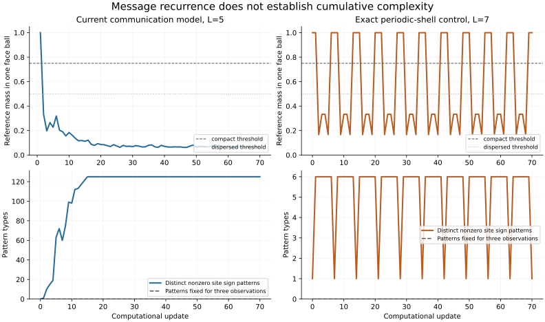

# Recurrent bursts and cumulative structure: finite audit

The requested cycle is **not demonstrated**: local messages should drive
reassembly after structural stagnation, trigger another expansion, and retain
information and more structure through successive cycles. The standalone communication control
has exact local transport and reception, but no demonstrated local stagnation
sensor or feedback mechanism that causes that cycle.

This audit adds passive measurements, explicit experimental feedback tensors,
and negative controls. It changes neither the physical Einstein law nor the scalar
engine. It does not replace a missing mechanism with a host-side detector,
periodic reset, injected pulse or complexity counter.

## What was measured

The [protocol](../experiments/cosmology/PROTOCOL.md) was fixed before the
candidate grid. For reference-channel amplitudes only, define
`w(x) = sum_g abs(b_g(x))`. A compact episode puts at least 3/4 of total `w`
in one center-plus-face-neighbors ball. Another episode counts only after
dispersal below 1/2. The first compact episode is preparation. Message-lane
focus is reported separately. These quantities are lattice diagnostics, not
physical mass, a spacetime scale factor or Einstein curvature.

At least four reassemblies are required. Across them, the vector of distinct
nonzero site sign patterns, undirected edge sign-pattern pairs, and patterns
persistent at one site over three observations must increase componentwise,
with at least one strict increase on each cycle and nonzero persistence.
Uniform positive amplitude scaling does not change these diagnostics. They
are finite structural proxies, not a definition of general physical complexity.

Feedback attribution and stagnation-trigger attribution are separate gates.
Unknown values remain unknown and cannot produce a positive result. The
complete `(a,b,r)` state must rewind exactly through every completed step.

## Results

The [machine-readable record](evidence/recurrent_bursts.json) contains every
case, tensor and state fingerprints, completed horizons, thresholds, resource
stops and source hashes. All 25 cases recovered their full initial states.

| Construction | Completed updates | Carrier refocuses | Reference reassemblies | Result |
|---|---:|---:|---:|---|
| Communication control, L=3 | 600 | 200 | 0 | Site-pattern count reaches 27 |
| Communication control, L=5 | 600 | 120 | 0 | Site-pattern count reaches 125 |
| Communication control, L=7 | 600 | 85 | 0 | Site-pattern count reaches 343 |
| No initial messages, L=5 | 160 | 0 | 0 | Reference board stays empty |
| Reception disconnected, L=5 | 160 | 32 | 0 | Messages travel; reference board stays empty |
| Doubled payload, L=5 | 160 | 32 | 0 | No recurrent reference reassembly |
| Six linear feedback tensors | 72–138 | See record | 0 each | All reach the 128-bit resource limit |
| Six cubic feedback tensors | 7–8 | See record | 1 each | All reach the 128-bit resource limit |
| Six spring feedback tensors | 45–87 | See record | 0 each | All reach the 128-bit resource limit |
| Periodic-shell calibration, L=7 | 70 | Separate construction | 10 | Same cycle repeats; no structural growth |

The communication-control site-pattern counts first reach their finite site-count ceilings
at updates 4, 15 and 30 respectively. No subsequent reassembly was detected
within the tested 600 updates. This does not rule out behavior beyond the
observed horizons or under other fixed laws and preparations.

Each feedback family uses coefficients `-3,-2,-1,1,2,3`, declared before the
runs. A one-node intervention changes neighboring message registers in all
18 candidates and not in the communication one-way control. This checks that the
feedback wiring operates; it does **not** establish that feedback causes
recurrent reassembly or senses a complexity plateau. Those gates remain
unestablished. Resource stops occur only after a complete exact step; no
counter is clipped and the entire saved state remains reversible.

### Detector calibration

After the first candidate grid failed, a separately labelled periodic control
was added. Six reference-labelled carriers use the proven translation stencil
and prepared previous histories, with no 48-channel reference block. They
expand and refocus on the periodic cube. The detector counts ten reassemblies
at updates `6,13,20,27,34,41,48,55,62,69`; the full state returns exactly at
`7,14,21,28,35,42,49,56,63,70`. Every detected reassembly has the same normalized
fingerprint and score `(6,6,0)`. Thus the detector recognizes real recurrence
while correctly rejecting it as cumulative structural growth.



The plotted computational update is an observation index; it is never an
input to the local tensor. The graph uses floating arithmetic only to render
already-saved exact ratios. State evolution and acceptance comparisons use
integers throughout.

## What must change to meet the target

The model needs an explicit local, reversible mechanism linking retained
structural memory to future messages, and those messages to reassembly when
structure stops developing. Adding an arbitrary reference-to-message term
did not supply that mechanism in this grid. It cannot be supplied by changing
observer thresholds or resetting a run after stagnation.

A completely periodic retained state has the same value of any single-valued
state score on each return. Any cumulative information must therefore live
in differing retained state across macro-cycles. Exact reversibility permits
such memory; it does not itself cause its accumulation. The selected finite
board counts are bounded, so they cannot grow strictly at every cycle forever.
An expanding board or a different justified complexity measure would require
an explicit new model and tests, not an amplitude-growth substitution.

## Reproduction and verification

Run from the repository root with Python 3.11 or newer:

```bash
python -m pip install '.[validation]'
OMP_NUM_THREADS=1 OPENBLAS_NUM_THREADS=1 python experiments/cosmology/recurrent_bursts.py --out runs/recurrent-bursts/verified-grid
python -m unittest universe24.tests.test_recurrent_bursts -v
OMP_NUM_THREADS=1 OPENBLAS_NUM_THREADS=1 python -m unittest discover -s universe24/tests -t . -v
# Optional rendering dependency; it is not used by evolution or audit tests.
python -m pip install matplotlib
python experiments/cosmology/plot_recurrent_bursts.py
```

Each case saves its actual tensor, complete initial and final states, full
state hashes and passive observations. Replaying those inputs uses the common
`Engine`, not an analytic animation. The full suite passes 134 tests, including
nine audit tests. An independent scalar oracle checked 5,832 transitions over
all 18 feedback tensors with zero mismatches; the detailed inputs are in the
evidence record.

The scalar-oracle check can be reproduced independently:

```python
from universe24.demos.communication.run_communication import build
from universe24.tools.audit_contract import scalar_crosscheck
from experiments.cosmology.recurrent_bursts import candidate_tensor, FAMILIES, COEFFICIENTS

_, base, _, _, _ = build(5, 'none')
for family in FAMILIES:
    for coefficient in COEFFICIENTS:
        result = scalar_crosscheck(candidate_tensor(base, family, coefficient), L=3)
        print(family, coefficient, result)
```

The research branch builds on communication commit
`90d8638c1ebf86021dde3371766acb42e0a42ee6` (PR #29). The Einstein work in PR #27
was inspected at `ba8b6c12066b0dbdf3f2001c9fa75571d7cff49b`. Its homogeneous
radiation example is a separate construction and still uses the retired `Q`
interface. It is not imported into this audit or evidence for a repeated
bounce. Integration requires a compatibility review against the fixed-six
engine and a fresh run of its own checks.

A [follow-up review on 11 November 2026](EINSTEIN_UPDATE_REVIEW.md) checks the
new ADM compiler in PR #27 at `335eb3c1b625075dbcca01f9cd61faffdd614600`.
A fixed-six compatibility port passes its focused tests, but its copied
per-node clock bank and finite compiled horizon do not supply the missing
local stagnation mechanism. The earlier burst results above are unchanged.

The [joint C2 and causal-cone audit](CLICK_CAUSALITY.md) links message reception
to later C2 records and tests the complete-event propagation bound. In the
80-update communication run, 94,043 C2 records occur after the structural
proxy vector plateaus; no reference reassembly follows. C2 is a passive
class, not an implemented complexity-generating or collapse-selection rule.
