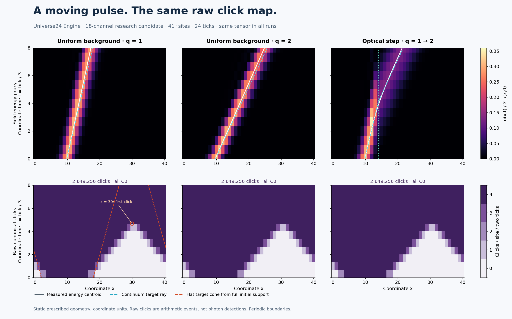

# Maxwell packet and canonical clicks

This is a new **research candidate**, not an accepted general Einstein model.
It is integrated into `python -m validation.system_acceptance --out runs/new-acceptance`
and uses the existing installed `python -m universe24` prepare/run/verify path.
No core Engine, tensor validator, decoder or saved-runtime schema was changed.

## Reproduce through main

The default input is the original flat 41³ packet, 24 ticks, binomial order 12,
center x=10 and Q=3²⁵. Use new output directories:

```bash
python -m validation.light_packet prepare-inputs --out runs/light-inputs
python -m universe24 prepare --tensor runs/light-inputs/tensor.json --seed runs/light-inputs/seed.json --channels runs/light-inputs/channels.json --protocol runs/light-inputs/protocol.json --model runs/light-inputs/model.json --out runs/light-bundle
python -m universe24 run --bundle runs/light-bundle --steps 24 --out runs/light-main
python -m universe24 verify --run runs/light-main
python -m validation.light_packet inspect --run runs/light-main --out runs/light-main-observations.json
```

The first command only writes complete input data. `universe24 prepare` seals
the same tensor, full seed, ownership and protocol. The main runtime alone
advances the state and saves full canonical transitions and all click records.
The final command replays that run and independently checks the scalar click
predicate, finite prepared shear oracle, full-state plane symmetry, exact
modified ledger and computational/target cones. A mismatched preparation,
history, interpretation, or declared horizon is rejected.

For the other original backgrounds, prepare fresh inputs with `--geometry fast`
or `--geometry step`; all three use the same tensor. The step is at x=14.
For a bounded local regression collection:

```bash
python -m validation.light_packet audit --out runs/light-regression
python -m unittest universe24.tests.test_light_packet -v
```

The central collection uses 13³ nodes and 6 ticks, with separate amplitude,
vacuum and low-precision controls. It is a fast full-record regression, not a
replacement for or relabeling of the original larger propagation experiment.
Canonical full-cube recording/replay is slower and larger than the archived
lossless plane compression; both retain every integer and every click.

## Algebra and ownership

| Item | Value |
| --- | --- |
| Retained channels | 18: X field group (6), Y field group (6), symmetric C (6) |
| Retained integers per node | 54: every channel's a,b,r |
| Scalar update | Exactly `divmod(2*u+r,6); a_next=b; b_next=ell-a` |
| Tensor | 162 integer monomials, maximum degree 2 |
| Physical support | Target plus at most one face edge per monomial |
| Old-a dependencies | None |
| Geometry | C=diag(1,q,q), equal prepared histories, frozen by the same Rule3 |
| Finite preparation | Q=3^(H+1); full old history a=F_inverse(b); all six carries present |
| Tensor SHA-256 | `256db395ebfd0456d72fb6bd7c65754896f984c3b4724f5462d6ac0dce96b177` |

The derivation and finite-sector proof are in [MODEL.md](../../MODEL.md#prepared-maxwell-test-field-on-a-static-optical-background).
The coordinate calibration is h=1, time=tick/3, with complete physical fields
at even ticks. It is not an operational clock. The intended metric is
Omega² diag(-1,1/q²,1/q,1/q); a coordinate speed of two for q=2 is not a
claim of local superluminal light. The arbitrary conformal factor is undetermined.

## Original experiment, preserved without relabeling

The original source used the unchanged Engine at
`e582960f6c9d2d134d3d6b28c08494e8bfafa86a`. Its four scripts are preserved
byte-for-byte in `docs/research/light_packet/original_source/`; their old relative output
paths are historical context, not new installed entry points. All original
full states and click records are retained in `runs/light-packet-clicks-v2/`.
Each stored (18,L) plane expands every x column L² times to recover the full
cube, whose symmetry was checked against every full-array value each step.

| Background | Target coordinate speed | Measured centroid speed | Canonical clicks |
| --- | ---: | ---: | ---: |
| q=1 | 1 | 0.928285 | 2,649,256, all C0 |
| q=2 | 2 | 1.893229 | 2,649,256, all C0 |
| q=1→2 | 2 in the second region | 1.884710, late fit | 2,649,256, all C0 |

Count/location/class maps and first-click times were identical in all three
cases, but quotient magnitudes and energy trajectories differed. The amplitude
control had energy ×4, quotient magnitude ×2 and unchanged click counts.
The broad-packet follow-up gave speed 0.972049 for target 1; it was exploratory,
not a matched fixed-domain mesh refinement. All original results, including
negative controls and boundary limitations, remain in the saved report.

At x=30 the flat first click occurred at tick 14, time 4.6667, although the
target cone from the complete initial a,b support x=2…18 reaches it no earlier
than time 12 (periodicity included). Its energy fraction was 2.00e-21. This is
a finite-grid tail, not evidence for physical faster-than-light photons.



[Animated saved states](Universe24_light_clicks.gif) ·
[Self-contained Hebrew report](Universe24_light_clicks_report_he.html)

## Physical gates

The finite prepared classical shear map and complete Rule3 replay pass.
Strict identification of raw clicks with the target null cone fails in the
declared larger experiment. General physical acceptance remains blocked:
no dynamic Einstein source, operational emitter/receiver/clock, universal
photon interpretation or Born statistics is supplied. The exact conserved
quantity is the modified symplectic ledger, not automatically the plotted
continuum energy proxy or a gravitational stress tensor. C1/C2 in the
low-precision control mark carry changes and loss of the exact prepared sector.

The central ledger explicitly rejects joining this test field to a different
gravity run as one physical construction. A green test reproducing a negative
control does not promote that rejected physical claim.
