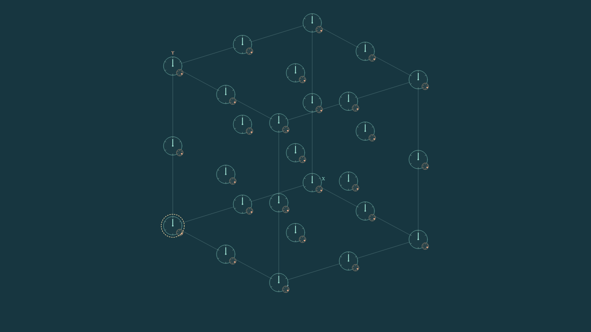

# Exact pattern families under one Rule3

The selected model uses `num=den=1` in every channel. This follow-up identifies
deliberately prepared, global patterns whose complete evolution follows a
reduced scalar recurrence with effective ratios `1`, `1/2` or `2/3`. No channel
coefficient, tensor, engine operation or click classifier changes during a run.

The [research document](https://docs.google.com/document/d/1NDPfeFj9vldgb0RMSSvx2lBSmOo__E-F3t2cZwfjOjI/edit)
already summarized homogeneous `1/2` and `2/3` encodings under the fixed rule.
This follow-up adds explicit proof assumptions, complete native controls and
independent replay; it does not claim the underlying idea originated here.

The [mathematical derivation](../clock_selection/invariant_families_algebra.md)
states the all-state assumptions. The [claim addendum](../clock_selection/invariant_families_claims.md)
keeps these new claims separate from the original 34-entry register and its
890 recorded runs. The [native results](results.md) and
[independent audit](evidence/independent_audit.json) verify all 48 registered
cases, 912 complete states, 864 transitions and 48 complete rewinds.
The separate [overlap study](overlap_results.md) adds four complete controls,
52 states and 48 transitions with independent replay. Together these two
follow-ups contain 52 recordings; the original 15 studies and 890 recordings
remain unchanged.

| Prepared pattern | Periodic side | Operator eigenvalue | Effective ratio |
|---|---:|---:|---:|
| Uniform in space and all channels | 3 | 6 | 1 |
| Spatial sequence `(1,-1,0)` along X | 3 | 3 | 1/2 |
| Spatial sequence `(1,0,-1,0)` along X | 4 | 4 | 2/3 |
| Internal channel pattern `(R(g)e_y)_y` at every node | 3 | 4 | 2/3 |

Each ternary pattern maps a single integer triple to every address. Positive
entries store `(a,b,r)`; negative entries store
`(-a,-b,4-r+2*(r mod 2))`; zero entries start at `(0,0,2)`. The full signed
remainder is essential. All addresses then evolve under the native rule.
The effective ratio describes an exact recurrence correspondence, not one
fitted frequency. In particular, the ratio-`2/3` cases have different periods
for different initial counters and remainders.

These are global invariant preparations on periodic cubes. They are not
localized components, photons, mass, spontaneous pattern formation or a proof
that arbitrary overlapping preparations add linearly. A zero total input may
be a cancellation of nonzero donor terms.

## View the recordings

Open the [nine-example Presenter](evidence/presenter_combined_v1/index.html):
five invariant-family examples and all four overlap controls, with every one
of their 147 saved states. The [combined study inventory](evidence/collection_v1/index.html)
links all 17 studies, 140 selected complete examples and 22,110 saved states.
These display counts are distinct from the complete research total of
942 recordings, 77,286 states and 76,344 independently replayed transitions.

The [five-example family page](evidence/presenter_v1/index.html) includes
all four patterns at `(a,b,r)=(0,1,2)` and the internal pattern at odd remainder
1. All 19 states of each example and all 48 channels remain available. The
uniform seeds drift; their moving hands do not imply a periodic clock.

From the repository root:

```sh
python -m http.server 8000
```

Then open
`http://localhost:8000/research/invariant_families_v1/evidence/presenter_combined_v1/index.html`.
Choose a recording, press Play or Step, and drag the cube to rotate it. A browser
must execute JavaScript; an attachment preview can display only a static shell.
The cube displays the currently selected channel at every node; all 48 channels
remain available in the channel selector and complete stored state.



This still is case `uniform-L3-r2-a0-b1`, state 0, selected channel 0. It is a
native Canvas rendering of the complete periodic cube, not a browser-layout
screenshot. The interactive page includes every later saved state.

The unchanged Presenter passed application JavaScript and native Canvas checks
for all nine examples, complete frame hashes, raw arithmetic C and rotation.
These checks use explicit emulated geometry and do not certify Safari/iPad
layout or touch interaction. The [check receipt](evidence/presenter_combined_checks/report.json)
states that scope.

## Overlapping preparations interact

The [four-control overlap](overlap_results.md) prepares the spatial period-four
and internal patterns on the same `L=4` board. At state 1, the joint counter
differs from the additive singleton prediction by +1 at 128 addresses and -1
at 128 addresses, with compensating remainder differences. This exact native
division carry was predicted before capture and independently replayed. Every
one of the 13 saved states, including all four null/singleton/joint controls,
is retained in the [overlap page](evidence/presenter_overlap_v1/index.html).

Both global patterns are present from startup. This result is an intrinsic
nonlinear interaction, not a localized collision, memory, force or a route
selection mechanism. The [integration note](../clock_selection/invariant_families_integration.md)
states the remaining requirements and distinguishes these global sectors
from the earlier guided-carrier/phase-clock interfaces.

## Reproduce or inspect

The new evidence is directly tracked; no additional evidence archive needs to
be restored. Verify every published new evidence file with:

```sh
python -m research.invariant_families_v1.verify_evidence
```

Run a fresh registered experiment only into a new directory:

```sh
python -m research.invariant_families_v1.run --preflight-output runs/invariant-preflight.json
python -m research.invariant_families_v1.budget --output runs/invariant-native
python -m unittest discover -s tests -p test_invariant_families_v1.py -v
```

The producer's complete workflow used 57.357 CPU seconds within its registered
180-second limit; the independent audit used 36.911 CPU seconds separately.
The [protocol](protocol.json) fixes every counter seed, remainder, tensor, cube
size, horizon, readout and budget before capture. Original executed sources,
all full native records, input sums, every C event and its six signed donor
values are retained under [native evidence](evidence/native_v1/).

The earlier [clock-selection inventory](../clock_selection/evidence/presentation_collection_v3/index.html)
and both previous checksum-locked archives remain unchanged. Restore them with
their documented commands before running the full repository suite.
