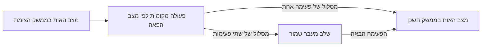

# הצומת, הפאות וגלגלי השיניים — המימוש המקומי

המימוש המאוחד נמצא ב־`validation/face_transport.py`. הוא רץ בחוק טנסור
קבוע אחד, במנוע הרגיל, עם מספרים טבעיים חיוביים בתחום ההתחלה המוגדר.
זו עדיין אינה הוכחה למרחב־זמן של איינשטיין.

## המבנה

לכל צומת שישה ממשקי פאה. לכל ממשק יש שני מצבי אות פנימיים. שתי הפאות
השכנות פונות לאותו מצב ממשק משותף; אין שני לינקים נפרדים ואין צורך
להוסיף שישה צמתים לרשת. החיבורים בין שכנים קבועים.

בממשק נשמרים מצב העיבוד והמידע שנמצא בשלב המעבר. הטנסור מחשב גם את
תנועת המידע וגם את השינוי במצב הממשק בעקבות המידע משני צדדיו. כל החישוב
קורא את אותו מצב קודם. אין תור חיצוני, מחיקת מידע או שינוי בטנסור בזמן ריצה.

## דימוי גלגל השיניים

פעימה יסודית היא עדכון אחד מ־before ל־after. מצב המנגנון קובע אם המעבר
לשכן מסתיים באותה פעימה או דורש שלב נוסף. בדימוי, זו שן אחת או שתיים.
הוספת השן משנה את מספר הפעימות הדרוש לסיום המעבר; היא אינה משנה את
חוק העדכון הבסיסי עצמו.

האותות גם משנים את מצב הפאה. אות שכבר נכנס לשלב המעבר יוצא בעדכון הבא,
גם אם מצב הפאה משתנה בינתיים. שתי כניסות יכולות להתקדם במקביל, בלי
למחוק אות כדי לפנות מקום לאחר.

## מה נמדד

| בדיקה | תוצאה |
| --- | --- |
| חוק אחד לכל המצב | טנסור קבוע מדרגה שלישית |
| תקציב | 25 ערוצים, 75 מספרים שמורים לכל תא אחסון |
| הרצות | 29 הרצות, 1,056 עדכונים |
| תנועה | נבדקו כל ששת הכיוונים ושני מצבי הכניסה |
| שינוי בעלות המעבר של אות הייחוס | 33,065 עליות ו־33,059 ירידות |
| שחרור שלב מעבר תפוס | 64,942 מקרים שנבדקו בהצלחה |
| טבעיים | נשמרו בכל המצב בתחום ההכנה שהוגדר |
| שחזור לאחור | מדויק, כולל השאריות |
| גודל מספר מרבי בהרצות | 9 ביטים; מונה הפעימות גדל |
| בדיקות תוכנה מלאות | 541 עברו, כולל שמירה, שחזור ובדיקות נגד |

גם מסלול האימות המרכזי הורץ מחדש: ביצוע התוכנה עבר; האישור הפיזיקלי
הכללי נשאר חסום. ההצלחות של מודלי איינשטיין המוגבלים במאגר אינן הוכחה
לגאומטריה של מנגנון הפאות החדש.

## הגבול המדויק של המודל

זמן המעבר תלוי גם במצב הכניסה של האות:

| מצב הפאה | מצב כניסה ראשון | מצב כניסה שני |
| --- | --- | --- |
| מצב 1 | פעימה אחת | שתי פעימות |
| מצב 0 | שתי פעימות | פעימה אחת |

לכן כרגע יש **מנגנון עיבוד בפאה**, ולא אורך גאומטרי יחיד שהוכח כתקף
לכל אות. המונה בצומת סופר פעימות; הוא עדיין אינו שעון עצמי יחסותי.
המודל אינו כולל זמן מעבר גדול משתיים, מתיחה של אות שכבר נכנס למסלול,
כוח קפיצי מחזיר או מנגנון מפצים.

במחקר קיימים מודלי הליכה קוונטית שבהם פעולות מקומיות על רשת קבועה
משחזרות תנועת חלקיק במרחב־זמן עקום בגבול רציף. זהו כיוון מחקר מתאים
למבנה, אך פעולות אלה שונות מהמנגנון הבוליאני שנבנה כאן. כדי לזהות כאן
גאומטריה איינשטיינית דרושים מטריקה משותפת, משוואות מקור ועקמומיות,
שעונים פיזיקליים ובדיקת התכנסות.

ההוכחה האלגברית, המקורות והוראות ההרצה נמצאים ב־
[FACE_PROCESSOR_MODEL.md](FACE_PROCESSOR_MODEL.md).
